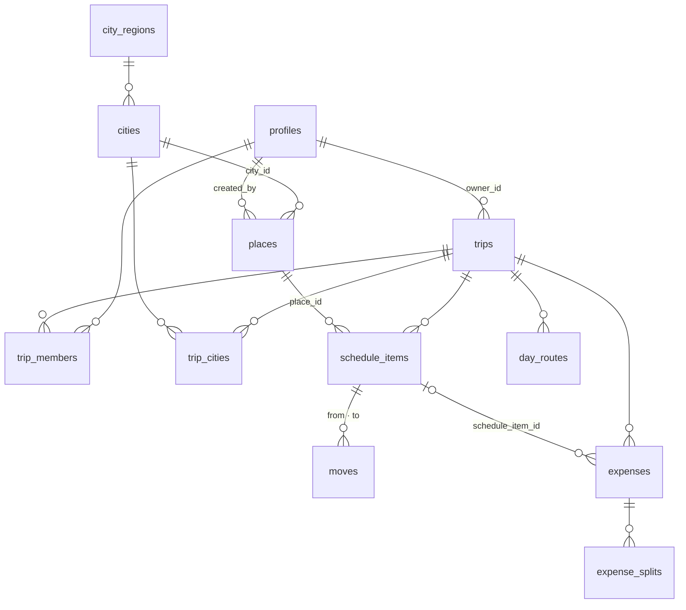

# 데이터 · 권한 정책

누가 어떤 데이터를 보고 고칠 수 있는지, 어떤 동작이 데이터를 어떻게 바꾸는지 모았다.
기능을 기획하거나 리뷰할 때 「이게 허용되나」를 판단하는 기준이다.

- **기준은 마이그레이션이다**(`supabase/migrations`). 이 문서는 요약과 이유이고, 둘이 다르면 마이그레이션이 맞다
- **마이그레이션을 바꾸면 이 문서도 같은 PR 에서 고친다.** 테이블 · 함수 이름이 여기 없으면 `supabase/migrations.test.ts` 가 막는다
- 동작은 `supabase/db.test.ts` 가 고정한다. 아래 「지키는 곳」의 테스트 이름이 그 테스트다

## 판단 기준 — 남의 데이터에 흔적을 남기는가

권한을 정할 때마다 이 질문을 한다(AGENTS.md 「인증 경계」).

- 자기 데이터만 바뀌는 동작은 넓게 허용한다. 익명(둘러보기) 계정도 자기 여행은 마음껏 고친다
- 남의 여행 · 남의 장소에 흔적이 남는 동작은 막는다. 익명은 남의 여행에 합류하지 못하고, 나간 멤버는 남은 여행의 장소를 고치지 못한다
- **Supabase 익명 사용자도 `authenticated` 다.** `to authenticated` · `auth.uid() is not null` 은 익명을 거르지 못한다. 구분은 JWT 의 `is_anonymous` 뿐이고, `assert_not_anonymous()` 한 곳에서 본다

---

## 테이블

| 테이블           | 무엇                                                                                  | 단위        |
| ---------------- | ------------------------------------------------------------------------------------- | ----------- |
| `profiles`       | 사람(이름 · 아바타). `auth.users` 가 생기면 트리거가 만든다                           | 사람        |
| `trips`          | 여행(제목 · 기간 · 통화 · 환율 · 초대 토큰)                                           | 여행        |
| `trip_members`   | 여행 멤버와 역할(owner · member)                                                      | 여행        |
| `city_regions`   | 해외 권역. 기준 데이터                                                                | 공용        |
| `cities`         | 도시(지도 중심 · 통화 · 시간대 · 포함 지역). 기준 데이터                              | 공용        |
| `trip_cities`    | 여행이 고른 도시와 순서                                                               | 여행        |
| `places`         | **장소** — 다음 여행에서도 맞는 정보(이름 · 위치 · 카테고리 · 별점 · 설명 · 링크)     | 사람 · 도시 |
| `schedule_items` | **일정** — 이번 방문에만 맞는 정보(날짜 · 순서 · 시각 · 예약 상태 · 메모 · 대체 장소) | 여행        |
| `moves`          | 두 장소 사이의 이동 방법(수단 · 상세)                                                 | 여행        |
| `day_routes`     | Routes API 경로 캐시(지도 화면)                                                       | 여행        |
| `expenses`       | 지출                                                                                  | 여행        |
| `expense_splits` | 지출을 누가 얼마씩 나누는지                                                           | 여행        |

**장소와 일정을 나눈 이유**: 같은 장소를 여러 여행 · 여러 날에 담아도 장소 정보는 한 번만 고치면 모든 일정에 반영된다.
일정은 `place_id` 로 장소를 참조할 뿐 복사하지 않는다. note · flight 일정은 장소가 없고 제목(`name`) · 설명을 직접 갖는다.
`emoji` 는 장소의 기본 아이콘이고, 일정의 `emoji` 는 그 일정에서만 바꾼 아이콘이다.

---

## 권한

익명 칸: **허용** = 자기 여행 · 자기 장소 안에서 됨, **거부** = 익명 계정은 못 함.

| 테이블                        | 읽기                                          | 만들기                                                         | 고치기                     | 지우기                                                                          | 익명          | 지키는 것                                                  |
| ----------------------------- | --------------------------------------------- | -------------------------------------------------------------- | -------------------------- | ------------------------------------------------------------------------------- | ------------- | ---------------------------------------------------------- |
| `profiles`                    | 로그인한 누구나                               | 가입 트리거만                                                  | 자기 것                    | 계정과 함께(cascade)                                                            | 허용          | `profiles_select` · `profiles_update_self`                 |
| `trips`                       | 소유자 · 멤버                                 | 소유자 = 나(`create_trip`)                                     | 멤버                       | 소유자                                                                          | 허용          | `trips_*` 정책                                             |
| `trip_members`                | 같은 여행 멤버                                | 정책 없음 — 여행 생성 트리거(소유자) · `join_trip_by_token` 만 | —                          | 본인(나가기) · 소유자(내보내기). 소유자 자신의 행은 DB 가 아직 막지 않는다(#72) | 합류 **거부** | `members_select` · `members_delete` · `join_trip_by_token` |
| `city_regions` · `cities`     | 로그인한 누구나                               | 마이그레이션만                                                 | 마이그레이션만             | 마이그레이션만                                                                  | —             | `*_read` (쓰기 정책 없음)                                  |
| `trip_cities`                 | 멤버                                          | 멤버                                                           | 멤버                       | 멤버                                                                            | 허용          | `trip_cities_*`                                            |
| `places`                      | 만든 사람 + 그 장소를 일정에 쓰는 여행의 멤버 | 만든 사람 = 나                                                 | **만든 사람만**            | **만든 사람만**, 쓰는 일정이 있으면 불가                                        | 허용          | `places_*` 정책 · FK `restrict`                            |
| `schedule_items`              | 멤버                                          | 멤버 + 붙일 수 있는 장소만                                     | 멤버 + 붙일 수 있는 장소만 | 멤버                                                                            | 허용          | `items_all` · `can_attach_place`                           |
| `moves`                       | 멤버                                          | 멤버 + 두 일정이 같은 여행                                     | 같음                       | 멤버                                                                            | 허용          | `moves_all` · 복합 FK                                      |
| `day_routes`                  | 멤버                                          | 멤버(경로 API)                                                 | 멤버                       | 멤버                                                                            | 허용          | `routes_all`                                               |
| `expenses` · `expense_splits` | 멤버                                          | 멤버                                                           | 멤버                       | 멤버                                                                            | 허용          | `expenses_all` · `splits_all`                              |

- **장소를 일정에 붙일 수 있는 조건**(`can_attach_place`): 내가 만든 장소, 또는 이 여행의 다른 일정이 이미 쓰는 장소(일행이 같은 곳을 한 번 더 담을 때).
  남의 보관함 장소 id 를 알아도 내 여행에 끌어와 읽을 수 없다
- **장소 수정을 넓히려면**(관리자 수정 · 승인) `places_update_owner` · `places_delete_owner` 두 정책만 고친다. 일정은 장소를 참조만 하므로 일정 쪽은 바뀌지 않는다

---

## 지켜야 하는 규칙과 지키는 곳

| 규칙                                                                                                                                                                         | 지키는 곳                                                                 | 고정한 테스트(`supabase/db.test.ts`)                                                                                                                                    |
| ---------------------------------------------------------------------------------------------------------------------------------------------------------------------------- | ------------------------------------------------------------------------- | ----------------------------------------------------------------------------------------------------------------------------------------------------------------------- |
| 여행 기간은 도착 ≥ 출발                                                                                                                                                      | check `trips_dates_chk`                                                   | trips › trips 를 직접 고쳐도 도착이 출발보다 앞서면 …                                                                                                                   |
| 여행을 만들 때 도시가 하나 이상 — **`create_trip` 경로에서만.** `trips` 직접 insert · `trip_cities` 삭제로 도시 없는 여행이 될 수 있고, 장소 담기는 그 경우를 처리한다(0015) | `create_trip`                                                             | create_trip › 도시가 없거나 없는 도시면 거부 …                                                                                                                          |
| 여행 소유자는 멤버다                                                                                                                                                         | 트리거 `handle_new_trip`                                                  | create_trip › 여행 · 도시 순서 · 소유자 멤버를 한 번에                                                                                                                  |
| 익명은 남의 여행에 합류하지 못한다                                                                                                                                           | `join_trip_by_token` 의 `assert_not_anonymous()`                          | `migrations.test.ts` › `%s` 의 익명 허용 여부가 정해져 있다(definer 함수마다 거부 헬퍼 호출 또는 허용 사유). 익명으로 직접 합류를 시도하는 동작 테스트는 아직 없다(#49) |
| 여행 날짜를 바꾸면 일정 · 지출이 함께 옮겨진다                                                                                                                               | `update_trip_dates` — **단, `trips` 직접 update 도 열려 있다(#47)**       | update_trip_dates › 줄이면 잘린 날의 일정은 …                                                                                                                           |
| place 일정 ⇔ 장소가 있다, note · flight 는 제목이 있다                                                                                                                       | check `schedule_items_place_kind_chk`                                     | schedule_items · places 칸 › place 는 장소가 있어야 하고 …                                                                                                              |
| 일정은 내 장소나 이 여행이 쓰는 장소만 참조한다                                                                                                                              | `items_all` with check + `can_attach_place`                               | places › 일행은 이 여행이 쓰는 장소를 한 번 더 담을 수 있지만 …                                                                                                         |
| 일정이 쓰는 장소는 지울 수 없다                                                                                                                                              | FK `schedule_items_place_fkey` `on delete restrict`                       | places › 일정이 쓰는 장소는 지울 수 없다                                                                                                                                |
| 같은 사람 · 같은 구글 장소는 장소 하나                                                                                                                                       | unique `places_owner_google_key` · `add_schedule_place`                   | places › 장소를 그날 끝에 담고, 같은 구글 장소를 다시 담으면 …                                                                                                          |
| 장소 이름은 1–100자                                                                                                                                                          | check · `add_schedule_place` 가 자르고 비면 거부                          | places › 이름은 앞뒤 공백을 떼고 100자로 …                                                                                                                              |
| 나간 멤버는 남은 여행의 장소를 고치지 못한다(소유자는 예외 — 나가기 대상이 아니다)                                                                                           | 트리거 `copy_places_on_leave`                                             | places › 멤버가 나가면 … 소유자 사본으로 / 나간 사람의 다른 여행은 원본을 …                                                                                             |
| 이동 기록의 두 일정은 같은 여행이다                                                                                                                                          | 복합 FK `(from_item_id, trip_id)` · `(to_item_id, trip_id)` + `moves_all` | moves › 같은 여행 조건은 FK 가 고정한다 …                                                                                                                               |
| 이동 기록은 쌍마다 하나, 비면 안 되고 상세는 60자                                                                                                                            | unique · check                                                            | moves › 두 장소 사이에 하나, 비어 있거나 60자를 넘으면 거부 …                                                                                                           |
| 도시 기준 데이터는 앱에서 못 바꾼다                                                                                                                                          | 쓰기 정책 없음                                                            | RLS › 도시 기준 데이터는 읽기만 …                                                                                                                                       |

---

## 동작별로 바뀌는 데이터

| 동작                     | 바뀌는 것                                                                                                                                                                                                                                                          | 어디서                        |
| ------------------------ | ------------------------------------------------------------------------------------------------------------------------------------------------------------------------------------------------------------------------------------------------------------------ | ----------------------------- |
| 가입(Google · 둘러보기)  | `profiles` 행이 생긴다. 이름은 OAuth 메타데이터, 둘러보기는 「둘러보는 중」                                                                                                                                                                                        | 트리거 `handle_new_user`      |
| 여행 만들기              | 여행 · 도시 · 소유자 멤버를 한 트랜잭션으로                                                                                                                                                                                                                        | `create_trip`                 |
| 초대로 합류              | 멤버 행 추가(이미 멤버면 그대로). 익명은 거부                                                                                                                                                                                                                      | `join_trip_by_token`          |
| 초대 링크 다시 만들기    | 옛 토큰은 더 이상 안 된다                                                                                                                                                                                                                                          | `rotate_invite_token`         |
| 여행 날짜 바꾸기         | 잘린 날의 일정은 마지막 날 끝으로(순서 유지), 지출은 출발일이 옮겨진 만큼 함께 옮기고 넘치면 도착일로, 사라진 날의 경로 캐시 삭제                                                                                                                                  | `update_trip_dates`           |
| 장소 검색으로 일정 추가  | 같은 구글 장소를 이미 담았으면 그 장소, 아니면 새 장소(도시 = 여행 도시 중 가장 가까운 곳 → 없으면 전체 도시 중 가장 가까운 곳) + 그날 끝 일정                                                                                                                     | `add_schedule_place`          |
| 멤버가 나가기 · 내보내기 | 그 사람이 만든 장소 중 이 여행이 쓰는 것을 여행 소유자 사본으로 바꾼다(소유자가 같은 구글 장소를 가지면 그것). 원본은 그 사람의 다른 여행에 남는다. 소유자 자신이 나가면 아무것도 바꾸지 않는다 — 소유자가 자기 행을 지우는 것은 지금 클라이언트에서만 막는다(#72) | 트리거 `copy_places_on_leave` |
| 일정 지우기              | 그 일정의 이동 기록이 함께 지워지고, 연결된 지출은 연결만 끊긴다                                                                                                                                                                                                   | FK cascade · set null         |
| 장소 지우기              | 쓰는 일정이 있으면 거부                                                                                                                                                                                                                                            | FK restrict                   |
| 여행 지우기(소유자)      | 멤버 · 도시 · 일정 · 이동 · 경로 · 지출이 함께 지워진다. 장소는 사람의 보관함이라 남는다                                                                                                                                                                           | FK cascade                    |
| 계정 지우기              | **아직 정하지 않았다**(#29). 소유한 여행(`trips.owner_id`) · 만든 장소(`places.created_by`) · 결제한 지출(`expenses.payer_id`) · 나눈 몫(`expense_splits.user_id`)이 `profiles` 를 참조해 지우기를 막는다                                                          | —                             |

---

## DB 함수

`security definer` 는 호출자 권한을 무시해 **RLS 가 걸리지 않는다.** 함수 안의 검사가 유일한 경계라서 만들 때마다 익명 허용 여부를 정한다.
이 판정은 `supabase/migrations.test.ts` 의 `ANONYMOUS_ALLOWED` 가 강제한다 — 새 definer 함수는 그 목록과 이 표에 함께 적는다.

| 함수                   | 종류             | 익명                                         | 하는 일                                               |
| ---------------------- | ---------------- | -------------------------------------------- | ----------------------------------------------------- |
| `handle_new_user`      | 트리거 · definer | 허용. 익명 가입도 프로필이 필요하다          | `auth.users` → `profiles`                             |
| `handle_new_trip`      | 트리거 · definer | 허용. 둘러보기가 이것 없이는 동작하지 않는다 | 여행 소유자를 멤버로                                  |
| `set_updated_at`       | 트리거 · invoker | —                                            | `updated_at` 갱신                                     |
| `is_trip_member`       | definer          | 판정 함수 자체                               | 내가 그 여행 멤버인지. RLS 대부분이 쓴다              |
| `join_trip_by_token`   | definer          | **거부**(`assert_not_anonymous`)             | 초대 토큰으로 합류                                    |
| `get_trip_preview`     | definer          | 허용. 읽기 전용 미리보기(비로그인 `anon` 도) | 초대 링크의 여행 미리보기                             |
| `rotate_invite_token`  | definer          | 멤버만(`is_trip_member`)                     | 초대 토큰 다시 만들기                                 |
| `assert_not_anonymous` | 헬퍼             | —                                            | 익명이면 예외. 익명 거부는 이 한 줄로만 쓴다          |
| `create_trip`          | invoker          | 허용(자기 여행)                              | 여행 + 도시 + 소유자 멤버                             |
| `update_trip_dates`    | invoker          | 허용(멤버)                                   | 기간 바꾸기 + 일정 · 지출 · 경로 캐시 정리            |
| `can_attach_place`     | definer          | 허용. 판정만 한다                            | 일정에 붙일 수 있는 장소인지. `items_all` 이 쓴다     |
| `add_schedule_place`   | invoker          | 허용(멤버)                                   | 장소(재사용 · 도시 결정 · 이름 정규화) + 그날 끝 일정 |
| `copy_places_on_leave` | 트리거 · definer | 트리거라 직접 못 부른다. 나가는 동작이 경계  | 나간 사람의 장소 → 소유자 사본                        |

**invoker 를 기본으로 한다.** 호출자 권한 그대로 RLS 가 걸려서, 함수가 정책을 우회할 길이 없다. definer 는 RLS 로는 표현할 수 없을 때만 쓴다
(정책끼리 서로를 부르는 경우 · 다른 사람 소유의 행을 만들어야 하는 경우).

---

## 실시간

`supabase_realtime` 에 `trips` · `trip_members` · `schedule_items` · `moves` · `places` · `expenses` · `expense_splits` 를 발행한다.
여행 화면은 여행 하나에 채널 하나를 열고(`features/trip/realtime-sync`) 변경이 오면 해당 쿼리를 다시 읽는다.

- 삭제 이벤트에도 옛 행 전체가 실리게 `replica identity full` 을 둔다(`schedule_items` · `moves` · `expenses` · `expense_splits` · `places`). `trip_id` 필터가 삭제에도 걸린다. `trip_members` 는 PK 에 `trip_id` 가 있어 기본값으로 충분하다
- `places` · `expense_splits` 는 `trip_id` 가 없어 필터 없이 구독한다. RLS 로 볼 수 있는 행만 온다

---

## 미정 · 다음 결정

- **장소 수정 권한 넓히기** — 지금은 만든 사람만. 관리자 수정이나 승인 방식이 필요해지면 정책 두 개만 고친다(사용자 결정 2026-10-04)
- **계정 삭제**(#29) — 소유한 여행과 만든 장소를 어떻게 할지. 장소는 `copy_places_on_leave` 와 같은 사본 방식을 재사용할 수 있다
- **여행 날짜 직접 update**(#47) — `trips_update_member` 가 날짜 칸도 열어 두어 `update_trip_dates` 를 우회할 수 있다
- **프로필 공개 범위** — `profiles_select` 가 로그인한 누구나 모든 프로필을 읽게 한다. 지금은 이름 · 아바타뿐이지만 칸이 늘면 같은 여행 멤버로 좁힌다
- **대체 장소** — 지금은 일정의 jsonb(`{name, gmap, …}`). 핸드오프는 장소 id 목록이라 일정 상세(#13 ③)에서 정한다
- **장소 슬라이스** — 장소 타입 · API 는 같은 레이어 import 규칙 때문에 `entities/schedule-item` 안에 있다. 가이드(#17)가 장소를 따로 다루면 `entities/place` 로 뺀다
- **오프라인 쓰기**(#31) — 대기 중인 뮤테이션의 표시 · 취소 · 실패
