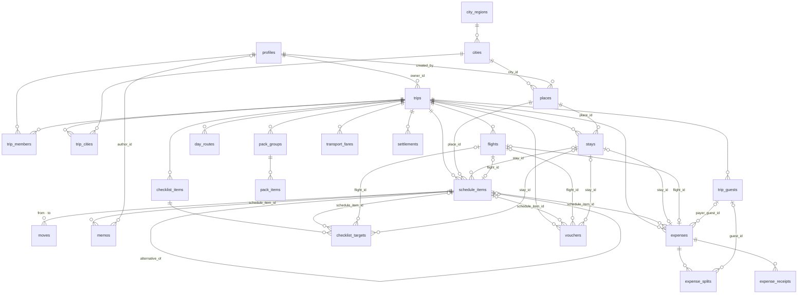

# 데이터 · 권한 정책

누가 어떤 데이터를 보고 고칠 수 있는지, 어떤 동작이 데이터를 어떻게 바꾸는지 모았다.
기능을 기획하거나 리뷰할 때 「이게 허용되나」를 판단하는 기준이다.

- **기준은 마이그레이션이다**(`supabase/migrations`). 이 문서는 요약과 이유이고, 둘이 다르면 마이그레이션이 맞다
- **마이그레이션을 바꾸면 이 문서도 같은 PR 에서 고친다.** 테이블 · 함수 이름이 여기 없으면 `supabase/migrations.test.ts` 가 막는다
- 동작은 `supabase/db.test.ts` 가 고정한다. 아래 「지키는 곳」의 테스트 이름이 그 테스트다

## 판단 기준 — 남의 데이터에 흔적을 남기는가

권한을 정할 때마다 이 질문을 한다(AGENTS.md 「인증 경계」).

- 자기 데이터만 바뀌는 동작은 넓게 허용한다. 익명(둘러보기) 계정도 자기 여행은 마음껏 고친다
- 남의 여행 · 남의 장소에 흔적이 남는 동작은 막는다. 익명은 남의 여행에 합류하지 못하고, 나간 멤버는 남은 여행의 장소를 고치지 못한다
- **Supabase 익명 사용자도 `authenticated` 다.** `to authenticated` · `auth.uid() is not null` 은 익명을 거르지 못한다. 구분은 JWT 의 `is_anonymous` 뿐이고, `assert_not_anonymous()` 한 곳에서 본다

---

## 테이블

| 테이블              | 무엇                                                                                                                                                                                                                         | 단위        |
| ------------------- | ---------------------------------------------------------------------------------------------------------------------------------------------------------------------------------------------------------------------------- | ----------- |
| `profiles`          | 사람(이름 · 아바타). `auth.users` 가 생기면 트리거가 만든다                                                                                                                                                                  | 사람        |
| `trips`             | 여행(제목 · 기간 · 통화 · 환율 · 초대 토큰 · 하루 요약)                                                                                                                                                                      | 여행        |
| `trip_members`      | 여행 멤버와 역할(owner · member)                                                                                                                                                                                             | 여행        |
| `city_regions`      | 해외 권역. 기준 데이터                                                                                                                                                                                                       | 공용        |
| `cities`            | 도시(지도 중심 · 통화 · 시간대 · 포함 지역). 기준 데이터                                                                                                                                                                     | 공용        |
| `city_areas`        | 도시별 지역 목록(이름 · 중심 좌표 · 반경 · 순서) — 홈 가이드 지역 필터 · 장소의 지역(`places.area_id`). 기준 데이터, 지금은 도쿄만                                                                                           | 기준        |
| `trip_cities`       | 여행이 고른 도시와 순서                                                                                                                                                                                                      | 여행        |
| `places`            | **장소** — 다음 여행에서도 맞는 정보(이름 · 위치 · 카테고리 · 별점 · 설명 · 링크)                                                                                                                                            | 사람 · 도시 |
| `trip_places`       | **여행 가이드 보관함** — 여행마다 일행과 함께 모은 장소(장소 · 담은 사람 · 이 여행의 메모). 일정에 넣은 장소는 저절로 들어가고 일정에서 지워도 남는다                                                                        | 여행        |
| `stays`             | **숙소 예약** — 장소(`place_id`, category stay)에 붙는 아이콘 · 예약 상태 · 숙박 날짜 · 체크인/아웃 시각 · 메모 · 링크. 묵는 날마다 일정 카드(`schedule_items.stay_id`)                                                      | 여행        |
| `flights`           | **항공편** — 항공사(이름 · 코드) · 편명 · 출발/도착 공항 · 날짜 · 시각 · 예약 상태 · 예약번호. 탑승일 day 끝에 일정 카드 하나(`schedule_items.flight_id`)                                                                    | 여행        |
| `checklist_items`   | **노트 · 체크리스트** — 상태(해야 할 것 · 기타 · 완료) · 제목 · 마감일 · 메모 · 링크 · 홈에 고정한 사람                                                                                                                      | 여행        |
| `checklist_targets` | **체크리스트 연결** — 항목 하나가 붙는 일정 카드 · 항공편 · 숙소 하나(한 줄에 정확히 하나)                                                                                                                                   | 여행        |
| `vouchers`          | **노트 · 바우처** — 제목 · 원본 파일 하나(키 · 이름 · 종류 · 크기) · PDF 현장용 페이지와 그 그림 · 썸네일 · 주인 · 번호 · 연결(일정 카드 · 항공편 · 숙소 중 하나) · 사용일 · 예약 사이트 · 메모 · 홈에 고정한 사람 · 쓴 시각 | 여행        |
| `pack_groups`       | **노트 · 준비물 · 쇼핑의 그룹** — 종류(pack · shop) · 이름 · 순서                                                                                                                                                            | 여행        |
| `pack_items`        | **노트 · 준비물 · 쇼핑의 항목** — 그룹 · 이름 · 메모 · 순서 · 챙김(체크한 사람 · 시각) · 쇼핑 참고 사진(사진 · 썸네일 키)                                                                                                    | 여행        |
| `transport_fares`   | **여행 홈 「교통」 의 1인 예상 교통비** — 날짜 줄(그날 · 금액 · 통화 · 경로 메모) · 날짜 밖 줄(이름 · 금액 · 통화 · 메모). 여행의 교통카드 · 패스 메모는 `trips.transport_note`                                              | 여행        |
| `schedule_items`    | **일정** — 이번 방문에만 맞는 정보(날짜 · 순서 · 시각 · 예약 상태 · 메모). 대체 장소도 일정 줄(`alternative_of`)                                                                                                             | 여행        |
| `memos`             | 일정에 붙는 메모 하나(작성자 · 본문 · ★ 중요 · 링크 · 홈에 고정한 사람)                                                                                                                                                      | 여행        |
| `moves`             | 두 장소 사이의 이동 방법(수단 · 상세)                                                                                                                                                                                        | 여행        |
| `day_routes`        | Routes API 경로 캐시(지도 화면)                                                                                                                                                                                              | 여행        |
| `expenses`          | 지출 — 항목명 · 금액 · 통화(+ 그 지출만의 환율) · 결제수단 · 카테고리 · 쓴 날(없으면 여행준비) · 합계 포함 여부 · 결제 상태                                                                                                  | 여행        |
| `expense_splits`    | 지출을 누가 얼마씩 나누는지                                                                                                                                                                                                  | 여행        |
| `trip_guests`       | **정산 인원** — 앱에 초대하지 않고 가계부 정산에만 넣는 사람(이름만, 1–20자)                                                                                                                                                 | 여행        |
| `settlements`       | 정산에서 **이미 보낸 돈** 한 줄(보낸 쪽 · 받는 쪽 · 금액)                                                                                                                                                                    | 여행        |
| `expense_receipts`  | 지출에 붙은 영수증 파일(사진 · PDF) 한 장 — 저장소 키 · 이름 · 종류 · 크기. 파일은 저장소(개발 중 Supabase Storage, 최종 R2)에                                                                                               | 여행        |

일정 링크(`schedule_items.links`, 예약 페이지 · 구매한 상품)는 이번 방문에만 해당해 장소 링크(`places.links`)와 따로 둔다. 예상 대기(`places.wait`)는 장소 정보다. 주소는 넷이다 — `address`(한국어로 요청한 번지 주소, 일본은 구글에 한국어 표기가 없어 로마자) · `address_local`(현지어, 현지인 · 택시에 보여 줄 용도) · `address_ko`(한글 — 일본은 한글 동네 이름 + 번지 숫자, 한국은 `address` 와 같아 비움) · `address_detail`(사용자가 적는 상세 위치 「파르코 본관 8F」). 화면은 로마자 → 현지어 → 한글 순으로 함께 적는다. 운영시간은 `hours`(매일 같음) · `hours_week`(요일별 `{ mon: "11:00–22:00", sun: null }` — null 은 휴무, 키가 없으면 모름) 둘이고, 요일 값이 하나라도 있으면 `hours_week` 를 본다.

**장소는 위치(`lat` · `lng`)가 반드시 있다.** 장소 입력 폼이 위치를 먼저 정하게 한다. 위치 없는 예전 데이터는 따로 받아 주지 않는다 — 화면은 그런 행이 와도 깨지지 않게만 하고(수정 폼은 위치를 정하기 전까지 저장 버튼이 꺼진다 — 따로 안내하지 않는다), 데이터는 정리 대상이다. DB 제약과 남은 이름만 담기 경로 정리는 #87.

**장소와 일정을 나눈 이유**: 같은 장소를 여러 여행 · 여러 날에 담아도 장소 정보는 한 번만 고치면 모든 일정에 반영된다.
일정은 `place_id` 로 장소를 참조할 뿐 복사하지 않는다. note · flight 일정은 장소가 없고 제목(`name`) · 설명을 직접 갖는다.
아이콘은 **일정**에 붙인다(0023). 장소 입력 폼 · 「이번 일정 · 수정」이 일정의 `emoji` 에 쓰고, 장소의 `emoji` 는 더 쓰지 않는다 — 장소는 함께 쓰는 정보라 한 사람이 바꾼 아이콘이 그 장소를 쓰는 모든 일정에 퍼지지 않게. 이미 있는 장소의 `emoji` 는 일정 아이콘이 없을 때 카드의 기본값으로 남는다.

**숙소 = 장소 + 숙소 예약**(0045 · 0046 · 0047 · 0048 · 0049, #88). 이름 · 주소 · 좌표 · 구글맵은 장소(`places`, category `stay`)에 있고 숙소(`stays`)는 예약 정보만 갖는다. 저장하면(`save_stay`) 체크인 ~ 체크아웃(양 끝 포함) 중 여행 기간 안의 날마다 그 장소의 일정 카드(`schedule_items.stay_id`)를 **그날에 이 숙소의 타임라인 카드가 없을 때만** 그날 끝에 하나 만든다 — 새 숙소이거나 숙박 날짜가 바뀐 때만(메모만 고쳤는데 사용자가 지운 카드가 되살아나지 않게). 그 뒤 카드는 일반 일정 카드다(순서 · 삭제 · 날짜 이동 모두 가능, 같은 숙소를 하루에 여러 번 넣을 수 있다). 이름 · 주소는 카드가 `place_id` 로 읽어 저절로 따라가고, 아이콘 · 예약 상태는 숙소 → 카드로 복사한다(트리거 `sync_stay_cards`). 기간을 줄이면 화면이 묻고 「지우기」 면 (옛 범위 ∖ 새 범위) 날의 연결 카드만 지운다(`p_prune`) — 사용자가 범위 밖으로 옮겨 둔 카드는 그대로. 숙소를 지우면(`delete_stay`) 「남기기」 는 FK 가 연결만 풀어 그 모습 그대로 일반 장소 카드가 되고, 「지우기」 는 연결 카드도 지운다. 장소는 보관함에 남는다. **「숙소로 등록」**(0048 `p_link_item`): 연결 없는 숙소 일정 카드에서 숙소를 만들면 그 카드에 `stay_id` 를 붙이고 장소 · 아이콘 · 예약 상태를 숙소 것으로 바꾼 뒤 묵는 날 카드를 채운다 — 그날은 이미 있으니 건너뛴다. 같은 여행의 · 아직 연결되지 않은 · **묵는 날 안의**(0049 — 폼에서 체크인을 바꿔 카드가 밖에 남지 않게) 타임라인 장소 카드만 되고, 아니면 숙소도 남기지 않고 거부한다. 숙박 날짜는 여행 기간 밖으로 나가도 된다(카드는 기간 안에만). **남의 장소를 고치면 사본으로**: 숙소를 다른 곳(다른 구글 장소 · 좌표)으로 옮기면 지금 장소를 고치지 않고 새 장소를 쓴다(0047 — 같은 장소를 재사용하는 다른 여행이 바뀌지 않게). 이름 · 주소만 고치면 내 장소는 그대로 고치고, 일행이 고치면 그 사람 소유의 장소 사본을 만들어 숙소 · 연결 카드가 그것을 가리킨다(copy-on-write, 2026-10-10 사용자 결정) — 「장소는 만든 사람만 고친다」 를 지키면서 일행도 오타를 고칠 수 있다. 원본은 주인 보관함에 그대로.

**항공편**(0052, #89). 항공편(`flights`)은 따로 저장하고, 탑승일이 여행 기간 안이면 그날에 그 항공편의 일정 카드(`schedule_items` kind `flight`, `flight_id`)가 하나 있다(`save_flight` 가 맞춘다 — 없으면 그날 끝에 만들고, 다른 날에 있으면 새 날 끝으로 옮기고(메모 유지), 기간 밖이면 지운다(메모도 함께 — 화면이 저장 전에 묻는다), 2026-10-12 사용자 결정). 카드의 제목(「ICN 07:15 - NRT 09:40」, `flight_card_name`) · 설명(「제주항공 · 7C1181」, `flight_card_description`) · 출발 시각 · 예약 상태는 항공편을 따른다(트리거 `sync_flight_card`). 항공편을 지우면 카드도 지운다(cascade). 항공사 · 공항 이름 목록은 앱(`entities/flight/lib`)에 있고 DB 는 IATA 코드 모양만 본다 — 목록에 없는 코드를 직접 넣을 수 있어 항공사 이름도 함께 저장한다. 여행 기간을 늘려 탑승일이 기간 안으로 들어오면 `update_trip_dates` 가 카드를 만든다(0053). 줄여서 밖이 되면 카드는 지우지 않고 마지막 날로 모인 채 남는다 — 다음 항공편 저장 때 확인창을 거쳐 지운다(메모가 말없이 사라지지 않게). 일정 편집 저장(`apply_schedule_edit`)은 카드를 지우지 않고 다른 날로 옮기지 않는다 — 같은 날 안의 순서만 바꾼다(0054, 화면도 고르지 못하게 막는다). 0054 전에 있던 flight 일정은 제목 「ICN 07:15 - NRT 09:40」 + 설명 「제주항공 · 7C1181」 형식이면 항공편으로 옮겨 카드로 이었다(탑승일 = 시작일 + 그 날, 도착 시각이 출발보다 앞서면 다음 날 도착). 형식이 다른 줄은 연결 없는 옛 줄로 남아 일반 일정처럼 고르고 지우고 옮긴다.

**숙소 결제 = 가계부 비용 한 건**(0051, #88 ③). 숙소의 결제는 `expenses.stay_id` 가 붙은 비용 하나다 — 숙소 화면과 가계부가 같은 줄을 보고 고친다. 숙소 하나에 비용은 하나(unique)이고, 숙소를 지우면 비용도 지운다(카드를 남겨도). 이름 · 카테고리는 숙소가 정한다 — 이름 = 숙소 장소 이름, 카테고리 = 숙소(`lodging`), 일정 연결 없음. 어느 경로로 저장하든 트리거(`set_stay_expense_fields`)가 덮어쓰고, 숙소의 장소가 바뀌거나(`sync_stay_expense_name`) 장소 이름이 바뀌면(`sync_place_stay_expenses`) 따라간다. 나머지(금액 · 통화 · 날짜 · 결제수단 · 결제 상태 · 사람 · 메모 · 영수증 · 합계 포함)는 일반 비용처럼 고친다. 비용을 지우면 숙소는 결제 없음으로 돌아간다. **숙소 카드에 「일정 연결」**(0073, #271): 가계부에서 숙소 카드(`schedule_items.stay_id` 가 있는 카드)를 고른 숙소 비용(카테고리 `lodging`)은 그 숙소에 결제가 없으면 숙소 결제로 저장한다(`link_stay_card_expense` — 이름 · 카테고리 · 일정 연결은 이어서 `set_stay_expense_fields` 가 맞춘다). 일정 연결 · 카테고리를 바꿀 때만 따지므로 금액만 고친 저장으로는 바뀌지 않는다. 결제가 이미 있는 숙소의 비용과 카테고리를 바꾼 비용(조식 = 식비)은 카드에 연결된 채 남아 숙소 상세의 「연결된 비용」 에 보인다. 0073 전에 숙소 카드에 붙어 있던 숙소 비용은 숙소마다 가장 먼저 만든 한 건을 결제로 옮겼다(항공편 0055 와 같다, 2026-10-31 사용자 결정).

**항공편 결제 = 가계부 비용 한 건**(0055, #89 ③). 숙소 결제와 같다 — `expenses.flight_id` 가 붙은 비용 하나, 항공편 하나에 하나(unique), 항공편을 지우면 비용도 지운다. 이름(「제주항공 7C1181」, `flight_expense_name`) · 카테고리(`flight`) · 일정 연결 없음은 트리거(`set_flight_expense_fields`)가 덮어쓰고, 항공사 · 편명을 고치면 이름이 따라간다(`sync_flight_expense_name`). 한 비용이 숙소 결제이면서 항공편 결제일 수는 없다(`expenses_one_owner_chk`). 결제를 넣는 사이 숙소 · 항공편이 지워졌으면 두 트리거가 23503 「stay not found」 · 「flight not found」 로 멈추고, 화면은 「… 지워졌어요」 로 알린다(0056). 0055 전에 항공편 카드에 「일정 연결」 로 붙어 있던 비용은 항공편마다 가장 먼저 만든 한 건을 그 항공편의 결제로 옮겼다(이름 · 카테고리가 바뀐다, 2026-10-13 사용자 결정). 나머지와 그 뒤에 카드에 연결한 비용은 카드에 연결된 채 남아 항공편 상세의 「연결된 비용」 에 보인다.

**체크리스트**(0057, #16). 노트의 체크리스트 항목(`checklist_items`)은 일행이 함께 보고 고친다(여행 멤버 누구나). 상태는 해야 할 것(`todo`) · 기타(`etc`) · 완료(`done`), 마감일은 날짜만. 「홈에 고정」 은 고정한 사람(`pinned_by`)을 적어 일행 모두에게 보이고 누구나 푼다(2026-10-13 사용자 결정, 홈 화면은 #17). **연결**(0058, ②-b): 항목은 일정 카드 · 항공편 · 숙소 여러 개에 붙는다(`checklist_targets`, 한 줄에 대상 하나). 항공편은 카드가 아니라 항공편에 붙어, 탑승일이 기간 밖이라 카드가 없어도 연결이 남는다. 대상이나 항목을 지우면 연결만 지운다(cascade). 추가 · 편집 창의 저장은 항목 칸과 연결을 한 트랜잭션으로 한다(`save_checklist_item`) — 편집이면 바뀐 칸 · 더하고 뺀 연결만 보내 그사이 일행이 바꾼 다른 칸 · 연결을 덮지 않고, 그사이 지워진 대상은 건너뛴다.

**준비물 · 쇼핑**(0060, #16). 노트의 준비물과 쇼핑 목록은 같은 모양이라 한 쌍의 테이블(`pack_groups` · `pack_items`)에 종류(`kind` = `pack` · `shop`)로 나눈다(2026-10-19 사용자 결정). 일행이 함께 보고 고친다(여행 멤버 누구나, 「내 것 / 공유」 구분 없음). 그룹 이름에 이모지를 그대로 넣고, 순서는 `position`(새 것은 맨 뒤). 항목의 챙김은 `checked_at`(시각)이 기준이고 `checked_by` 는 체크한 사람 — 누구나 체크하고 푼다. 체크한 사람이 나가 프로필이 지워져도 챙김은 남는다(`checked_by` 만 비운다). 체크해도 자리는 그대로다. 항목 상세에서 다른 그룹으로 옮기면 그 그룹 맨 뒤로 가고, 챙김을 그대로 두고 저장하면 체크한 사람 · 시각을 남긴다(바뀐 칸만 저장). 「모두 해제」 는 그 종류에서 챙긴 항목의 체크를 모두 푼다. 그룹을 지우면 항목도 지운다(cascade). 「기본 목록으로 시작」 은 그룹 여러 개와 항목을 한 트랜잭션으로 넣는다(`add_pack_groups`). 그 종류에 그룹이 하나라도 있으면 아무것도 하지 않는다 — 일행 둘이 함께 누르거나 두 기기에서 눌러도 한 벌만(여행 · 종류마다 트랜잭션 잠금, 0061). **쇼핑 참고 사진**(0062): 항목 하나에 한 장, 화면이 줄인 사진(`photo_key`)과 목록 썸네일(`thumb_key`)을 함께 두거나 둘 다 비운다(`pack_items_photo_chk`). 키는 그 여행 폴더 안(`pack_items_photo_keys_chk`)이고 두 키 모두 줄마다 겹치지 않아(unique) 항목을 지우거나 사진을 바꿀 때 그 키를 바로 지워도 된다. 파일은 비공개 버킷 `pack-photos`(정책 `pack_photos_member_*`)에 두고, 항목 · 그룹을 지우거나 사진을 바꾸면 화면이 지운다. 파일 규칙은 [`files.md`](files.md) 「쇼핑 참고 사진」.

**교통비**(0072, #17 ⑥). 여행 전에 적어 두는 1인 예상 교통비 — 일행이 함께 보고 고친다(여행 멤버 누구나). 날짜 줄은 날짜(`day_index`)마다 하나(`transport_fares_day_key`)이고 이름이 없다. 날짜 밖 줄(공항 왕복 · 교통 패스)은 `day_index` 가 비고 이름(1–30자)이 있다(`transport_fares_kind_chk`). 금액(1인)은 비울 수 있고, 날짜 줄은 금액이나 메모 중 하나는 있다(`transport_fares_filled_chk`) — 화면은 둘 다 비우고 저장하면 줄을 지운다. 금액은 그 줄의 통화(여행 통화 중 하나, 화면이 고른다)로 두고 합계는 화면이 통화별로 더한다. 날짜는 일정처럼 `day_index` 기준이라 출발일을 옮겨도 그 차례에 남고, 기간을 줄여 밖으로 나간 줄은 보이지도 더해지지도 않을 뿐 지우지 않는다. 메모 200자. 여행의 교통카드 · 패스 메모는 `trips.transport_note`(500자, 비우면 null) — 여행 칸이라 `trips_update_member` 가 그대로 걸린다. 오프라인에서는 고칠 수 없다(현장 동작이 아니라 대기열에 넣지 않는다).

**바우처**(0059, #16). 노트의 바우처(`vouchers`)는 일행이 함께 보고 고친다(여행 멤버 누구나). 원본 파일은 하나(사진 또는 PDF)이고 **압축하지 않는다**(20MB 까지) — 파일 없이 번호만 있는 바우처도 된다. PDF 는 올리는 사람의 브라우저가 현장용 페이지(`pages`, 폼에 적은 글자 그대로 「1, 3」)를 그림으로 만들어 `page_keys` 에, 목록 썸네일을 `thumb_key` 에 둔다(그리지 못하면 비어 있고 뷰어는 원본을 연다). 주인(`owners`, 멤버 id 목록)이 비면 「모두」, 번호(`numbers`)는 `[{ label, owner, value }]`. **연결은 하나**(일정 카드 · 항공편 · 숙소 중 하나이거나 없음 = 기타, 2026-10-15 사용자 결정)이고 대상을 지우면 그 칸만 비운다(`on delete set null (칸)`). 사용일(`use_date`)은 연결이 없을 때만 둔다. **「사용했어요」**(0074, #276): 현장에서 쓴 바우처는 쓴 시각(`used_at`)을 남긴다 — 일행 누구나 표시 · 되돌리기(비우기). 쓴 바우처는 홈 「오늘 쓸 바우처」 에서 빠지고, 노트 목록에서는 흐리게 「사용함」 으로 그 묶음 맨 아래에 온다. 파일 규칙은 [`files.md`](files.md) 「바우처」.

**메모는 목록이다**(0027, `memos`). 메모 하나가 한 줄이고 작성자 · ★ 중요 · 링크(제목 + URL)를 갖는다. 장소 · 항공편 일정 줄에 붙어(대체 장소 줄도) 「바꾸기」 하면 장소를 따라가고, 일정을 지우면 함께 지워진다. **날짜 메모(note 일정)에는 붙지 않는다** — 날짜 메모는 글 한 칸(`name`, 여러 줄 · 중요는 앞에 「★ 」)이고 「시간 + 메모」 창으로만 고친다(0029, 예전에 붙은 메모는 글 아래에 합쳤다). 여행 멤버 누구나 쓰고 고치고 지운다(사용자 결정 2026-10-05). 예전 일정 메모 칸(`schedule_items.memo`)은 줄마다 메모 하나로 옮기고 지웠다. **「홈에 고정」**(0064): 장소 메모(`memos.pinned_by`)와 날짜 메모(`schedule_items.pinned_by`, note 일정만 — check)에 고정한 사람을 적는다. 체크리스트 · 바우처와 같이 일행 모두의 홈에 보이고 누구나 푼다. ★ 중요와는 따로다(중요 표시만으로는 홈에 뜨지 않는다, 사용자 결정 2026-10-27).

**대체 장소도 일정 한 줄이다**(0024, `alternative_of` = 붙은 일정). 타임라인 · 동선 · 개수는 `alternative_of` 가 빈 줄만 본다. 예약 상태 · 일정 링크 · 메모(`memos`) · 지출 연결(`expenses.schedule_item_id`, 앞으로 바우처 · 할 일)은 줄마다 따로라 「바꾸기」 하면 각자 장소를 따라간다(지출 폼이 대체 장소 줄을 보이지 않는 문제는 #91). 시간 · 이동 기록은 「자리」 의 것이라 대체 장소 줄은 시간이 없고(check), 바꾸기 할 때 새로 들어온 줄로 옮긴다. 같은 여행의 타임라인 장소 줄에만 붙고(FK · 트리거), 대체 장소의 대체 장소는 없고, 붙은 일정과 같은 날이다(넣을 때 · 옮길 때 트리거가 맞춘다). 붙은 일정을 지우면 함께 지워진다.

**지출**(0033). 쓴 날(`expenses.spent_on`)이 **비어 있으면 「여행준비」** 다 — 출발 전에 쓴 돈(숙소 · 항공 · eSIM)이고, 실제 결제한 날짜는 적지 않는다(2026-10-06 사용자 결정). 환율은 여행의 기본값(`trips.exchange_rates`)을 쓰되 지출마다 덮어쓸 수 있다(`rate` = 기준 화폐 / 통화 1단위, 100엔 = 888.3원이면 8.883). **합계 포함 여부(`counted`)와 결제 상태(`paid` · `due_date`)는 별개다** — 합계에서 뺀 지출은 총합계 · 통화별 · 날짜별 합계 · 통계 · 정산 어디에도 넣지 않고, 결제 예정인 지출은 모두 넣는다. 카테고리는 7개(`lodging` 숙소 · `flight` 항공 · `transport` 교통 · `activity` 관광 · `food` 식비 · `shopping` 쇼핑 · `other` 기타), 결제수단은 `card` 카드 · `cash` 현금 · `transit` 교통카드 — 새 비용은 앱이 카드로 시작한다(#286). DB 기본값(`cash`, 0033)은 그대로 두었다 — 앱은 늘 결제수단을 함께 보낸다. 계산은 `entities/expense/lib`(`toHomeFor` · `sumExpenses` · `computeNetBalances`)에 있다.

**지출의 사람**(0034). 비용의 **결제자**와 **나눌 사람**은 멤버(`user_id`)이거나 **정산 인원**(`guest_id`)이다 — 둘 중 하나만 채운다(check). 정산 인원은 앱에 초대하지 않고 이름만 넣는 사람이라 `profiles` 에 두지 않는다(로그인 계정이 아니고, `auth.users` 와 어긋나면 안 된다). **「각자 냄」**(`expenses.split_each`)은 각자 자기 몫을 낸 비용이라 결제자가 없고 정산에서 빠진다. 나눌 사람은 그대로 둔다 — 「누가 얼마를 썼는지」(개인별 지출)에는 들어가기 때문이다.

**지출 고치기**(#130). 수정 화면은 폼을 연 때와 **달라진 칸만** 보낸다 — 열어 둔 사이 일행이 바꾼 결제 상태 · 합계 포함 · 환율을 연 때의 값으로 되돌리지 않는다. 제약으로 묶인 칸(결제자 · 정산 인원 결제자 · 각자 냄, 결제 상태 · 예정일)은 하나만 바뀌어도 묶음째 보낸다 — 일부만 보내면 그사이 일행이 묶음의 다른 칸을 바꿨을 때 check 에 걸린다. 나눔 줄(`expense_splits`)은 금액 · 통화 · 함께한 사람 중 하나가 바뀔 때만 균등으로 다시 쓰고, 그때는 금액 · 통화 · 환율을 바뀌지 않았어도 함께 보낸다(몫은 그 금액 기준이라 — 그사이 일행이 금액을 바꿨으면 내 금액으로 맞춘다). 직접 나누기(`split_mode = 'custom'`)는 화면에서 뺐지만, 예전에 직접 나눈 지출도 이 셋을 건드리지 않으면 몫과 나눔 방식이 그대로 남는다.

**지출의 일정 연결**(#18 ⑦). 비용은 타임라인 일정이나 대체 장소 줄에 연결할 수 있고(`expenses.schedule_item_id`), 여행준비 비용도 연결할 수 있다. 날짜를 바꿔도 연결은 남는다(화면이 「연결된 일정은 day N이에요」 로 알린다). 연결하면 날짜 · 카테고리를 그 일정으로 채우되 그 화면에서 사용자가 직접 바꾼 칸은 덮지 않고, 항목명을 비우면 일정 이름으로 저장한다. **합계 포함은 대체 장소 여부가 바뀔 때만 따라간다** — 대체 장소에 연결하면 빼고, 대체 장소에서 타임라인 일정으로 옮기거나 연결을 지우면 넣는다(「바꾸기」 와 같은 규칙). 같은 종류끼리 옮기면 사용자가 바꾼 값을 둔다.

**정산**(0034). 「누가 누구에게 얼마를」 은 비용에서 계산하고, **이미 보낸 돈**(`settlements`)만 뺀다. 비용 · 송금 기록에 쓰고 있는 정산 인원은 뺄 수 없다(FK `on delete restrict`, 0035). 「받았어요 · 보냈어요」 를 누르면 그 줄이 생기고, 취소하면 지운다. 계산된 송금 쌍에 표시를 다는 대신 기록을 남기는 이유는, 비용이 나중에 바뀌어도 이미 보낸 돈은 그대로 남고 남은 금액만 다시 계산되기 때문이다(2026-10-06 사용자 결정).

**영수증**(0041 · 0042). 지출에 사진 · PDF 를 3장까지 붙인다(`expense_receipts`). 파일은 고르는 순간 저장소에 올리고 지출을 저장할 때 표에 붙인다 — 붙지 못한 파일은 따로 정리한다(#155). 키는 `{여행 id}/{uuid}.{확장자}` 라 경로 첫 칸으로 멤버를 가린다. 저장소는 최종 Cloudflare R2 이고 그 전까지 Supabase Storage 비공개 버킷 `receipts` 를 쓴다(`docs/engineering/library-policy.md`). 올리기 · 보기 · 지우기는 늘 서버 라우트(`/api/receipts`)가 멤버를 확인하고 발급한 서명 주소로 한다 — 저장소를 바꿔도 화면은 그대로다. 버킷에도 같은 경로 규칙의 정책(`receipts_member_*`)을 건다. 지출을 지우면 표의 줄은 함께 지워지고(cascade) 파일은 화면이 지운다. 파일 규칙 · 압축 · 지우기는 [`files.md`](files.md).

**프로필 사진**(0043). `profiles.avatar_url` 은 「지금 보이는 사진」(헤더 · 멤버 · 메모 · 가계부가 이 칸만 읽는다), `default_avatar_url` 은 가입 때 받은 구글 사진이다 — 「기본 이미지로」 가 여기로 되돌린다(없으면 이니셜). 사진은 Supabase Storage **공개** 버킷 `avatars` 에 `{사용자 id}/{uuid}.jpg` 로 두고 공개 주소를 `avatar_url` 에 적는다(곳곳에서 그리므로 서명 주소를 쓰지 않는다 — 키를 짐작할 수 없다). 올리기 · 지우기는 서버 라우트(`/api/avatars`)가 발급한 서명 주소로 하고, 버킷 정책(`avatars_own_*`, 0043 · 0044)이 자기 폴더만 허용한다 — Storage 의 지우기는 파일을 RLS 로 먼저 찾아서 공개 버킷이어도 자기 폴더 읽기 정책이 있어야 한다(없으면 오류 없이 0건 지움). 둘러보기(익명)는 올리지 못한다. 단 `profiles_update_self` 가 자기 행의 모든 칸을 열어 두어 `avatar_url` · `default_avatar_url` 은 본인이 아무 주소로나 바꿀 수 있다 — DB 에서 막는 일은 #181. 자세한 규칙은 [`files.md`](files.md).

- **대체 장소 「바꾸기」 는 합계 포함 여부를 덮어쓴다**(0033). 대체 장소가 된 일정의 지출은 모두 빼고, 타임라인에 올라온 일정의 지출은 모두 넣는다 — 사용자가 손으로 바꾼 값과 구분하지 않는다
- **대체 장소가 된 줄을 「빼기」 로 지우면** 그 줄의 지출은 연결이 끊기고(`set null`) 합계에서 뺀 채로 남는다(#92 결정 — `counted` 는 그대로 둔다)
- 두 경우 모두 비용 입력 화면의 「합계에서 제외」 스위치로 지출마다 다시 바꾼다. 「바꾸기」 가 손으로 바꾼 값까지 덮는 규칙은 그대로 둔다(#18 ⑥ — 시안이 「대체 장소로 바뀐 일정의 비용은 자동으로 제외돼요」 라고 화면에 알린다)

---

## 권한

익명 칸: **허용** = 자기 여행 · 자기 장소 안에서 됨, **거부** = 익명 계정은 못 함.

| 테이블                                   | 읽기                                                        | 만들기                                                                        | 고치기                                                   | 지우기                                                                          | 익명                                                               | 지키는 것                                                    |
| ---------------------------------------- | ----------------------------------------------------------- | ----------------------------------------------------------------------------- | -------------------------------------------------------- | ------------------------------------------------------------------------------- | ------------------------------------------------------------------ | ------------------------------------------------------------ |
| `profiles`                               | 로그인한 누구나                                             | 가입 트리거만                                                                 | 자기 것                                                  | 계정과 함께(cascade)                                                            | 허용(사진 **올리기만** 거부 — 주소 칸은 본인이 고칠 수 있다, #181) | `profiles_select` · `profiles_update_self` · `avatars_own_*` |
| `trips`                                  | 소유자 · 멤버                                               | 소유자 = 나(`create_trip`)                                                    | 멤버                                                     | 소유자                                                                          | 허용                                                               | `trips_*` 정책                                               |
| `trip_members`                           | 같은 여행 멤버                                              | 정책 없음 — 여행 생성 트리거(소유자) · `join_trip_by_token` 만                | —                                                        | 본인(나가기) · 소유자(내보내기). 소유자 자신의 행은 DB 가 아직 막지 않는다(#72) | 합류 **거부**                                                      | `members_select` · `members_delete` · `join_trip_by_token`   |
| `city_regions` · `cities` · `city_areas` | 로그인한 누구나                                             | 마이그레이션만                                                                | 마이그레이션만                                           | 마이그레이션만                                                                  | —                                                                  | `*_read` (쓰기 정책 없음)                                    |
| `trip_cities`                            | 멤버                                                        | 멤버                                                                          | 멤버                                                     | 멤버                                                                            | 허용                                                               | `trip_cities_*`                                              |
| `places`                                 | 만든 사람 + 그 장소를 일정 · 숙소 · 보관함에 둔 여행의 멤버 | 만든 사람 = 나                                                                | **만든 사람만**                                          | **만든 사람만**, 쓰는 일정 · 보관함이 있으면 불가                               | 허용                                                               | `places_*` 정책 · FK `restrict`                              |
| `trip_places`                            | 멤버                                                        | 멤버 + 붙일 수 있는 장소만(`can_attach_place`). 일정에 장소를 넣으면 트리거도 | 멤버 — 메모만(칸 권한)                                   | 멤버. 이 여행 일정(대체 장소 포함)에 있는 장소는 불가 — 막히면 0행              | 허용                                                               | `trip_places_*` · 트리거 `add_trip_place_from_item`          |
| `stays`                                  | 멤버                                                        | 멤버 + 붙일 수 있는 장소만(`can_attach_place`)                                | 멤버                                                     | 멤버. 연결 카드는 남기거나 함께 지운다(`delete_stay`)                           | 허용                                                               | `stays_all`                                                  |
| `flights`                                | 멤버                                                        | 멤버                                                                          | 멤버                                                     | 멤버. 연결 카드도 함께(cascade)                                                 | 허용                                                               | `flights_all`                                                |
| `checklist_items`                        | 멤버                                                        | 멤버                                                                          | 멤버                                                     | 멤버                                                                            | 허용                                                               | `checklist_items_all`                                        |
| `checklist_targets`                      | 멤버                                                        | 멤버                                                                          | 멤버                                                     | 멤버. 항목 · 대상을 지우면 함께(cascade)                                        | 허용                                                               | `checklist_targets_all`                                      |
| `vouchers`                               | 멤버                                                        | 멤버 — 그 여행 폴더 키만, 연결은 같은 여행 대상 하나까지                      | 멤버 — 그 여행 폴더 키만, 연결은 같은 여행 대상 하나까지 | 멤버. 대상을 지우면 연결 칸만 비운다(set null)                                  | 허용                                                               | `vouchers_all` · `vouchers_*_fkey` · `vouchers_keys_chk`     |
| `pack_groups`                            | 멤버                                                        | 멤버                                                                          | 멤버                                                     | 멤버. 항목도 함께(cascade)                                                      | 허용                                                               | `pack_groups_all`                                            |
| `pack_items`                             | 멤버                                                        | 멤버 — 같은 여행의 그룹에만                                                   | 멤버 — 같은 여행의 그룹에만                              | 멤버                                                                            | 허용                                                               | `pack_items_all` · `pack_items_group_fkey`                   |
| `transport_fares`                        | 멤버                                                        | 멤버                                                                          | 멤버                                                     | 멤버                                                                            | 허용                                                               | `transport_fares_all`                                        |
| `schedule_items`                         | 멤버                                                        | 멤버 + 붙일 수 있는 장소만                                                    | 멤버 + 붙일 수 있는 장소만                               | 멤버                                                                            | 허용                                                               | `items_all` · `can_attach_place`                             |
| `memos`                                  | 멤버                                                        | 멤버(작성자 = 나, 트리거)                                                     | 멤버(작성자는 그대로)                                    | 멤버                                                                            | 허용                                                               | `memos_all` · `keep_memo_author` · 복합 FK                   |
| `moves`                                  | 멤버                                                        | 멤버 + 두 일정이 같은 여행                                                    | 같음                                                     | 멤버                                                                            | 허용                                                               | `moves_all` · 복합 FK                                        |
| `day_routes`                             | 멤버                                                        | 멤버(경로 API)                                                                | 멤버                                                     | 멤버                                                                            | 허용                                                               | `routes_all`                                                 |
| `expenses` · `expense_splits`            | 멤버                                                        | 멤버                                                                          | 멤버                                                     | 멤버                                                                            | 허용                                                               | `expenses_all` · `splits_all`                                |
| `trip_guests` · `settlements`            | 멤버                                                        | 멤버                                                                          | 멤버                                                     | 멤버                                                                            | 허용                                                               | `trip_guests_all` · `settlements_all`                        |
| `expense_receipts`                       | 멤버                                                        | 멤버 — 같은 여행 지출에만, 그 여행 폴더 키만, 지출당 3장(트리거, 0042)        | —                                                        | 멤버 · 지출과 함께(cascade)                                                     | 허용                                                               | `expense_receipts_all` · `expense_receipts_limit`            |

- **장소를 일정에 붙일 수 있는 조건**(`can_attach_place`): 내가 만든 장소, 또는 이 여행의 다른 일정 · 숙소가 이미 쓰는 장소(일행이 같은 곳을 한 번 더 담을 때). 장소 읽기(`places_select`)도 같다 — 숙소가 쓰는 장소는 연결 카드가 0장이어도 그 여행 멤버가 읽는다.
  남의 보관함 장소 id 를 알아도 내 여행에 끌어와 읽을 수 없다
- **장소 수정을 넓히려면**(관리자 수정 · 승인) `places_update_owner` · `places_delete_owner` 두 정책만 고친다. 일정은 장소를 참조만 하므로 일정 쪽은 바뀌지 않는다

---

## 지켜야 하는 규칙과 지키는 곳

| 규칙                                                                                                                                                                                   | 지키는 곳                                                                                                                                                        | 고정한 테스트(`supabase/db.test.ts`)                                                                                                                                    |
| -------------------------------------------------------------------------------------------------------------------------------------------------------------------------------------- | ---------------------------------------------------------------------------------------------------------------------------------------------------------------- | ----------------------------------------------------------------------------------------------------------------------------------------------------------------------- |
| 여행 기간은 도착 ≥ 출발                                                                                                                                                                | check `trips_dates_chk`                                                                                                                                          | trips › trips 를 직접 고쳐도 도착이 출발보다 앞서면 …                                                                                                                   |
| 여행 도시가 하나 이상 — **`create_trip` · `set_trip_cities` 경로에서만.** `trips` 직접 insert · `trip_cities` 삭제로 도시 없는 여행이 될 수 있고, 장소 담기는 그 경우를 처리한다(0015) | `create_trip` · `set_trip_cities`                                                                                                                                | create_trip › 도시가 없거나 없는 도시면 거부 … · 여행 도시 바꾸기 › 빈 목록 · 겹친 도시 …                                                                               |
| 여행 소유자는 멤버다                                                                                                                                                                   | 트리거 `handle_new_trip`                                                                                                                                         | create_trip › 여행 · 도시 순서 · 소유자 멤버를 한 번에                                                                                                                  |
| 익명은 남의 여행에 합류하지 못한다                                                                                                                                                     | `join_trip_by_token` 의 `assert_not_anonymous()`                                                                                                                 | `migrations.test.ts` › `%s` 의 익명 허용 여부가 정해져 있다(definer 함수마다 거부 헬퍼 호출 또는 허용 사유). 익명으로 직접 합류를 시도하는 동작 테스트는 아직 없다(#49) |
| 여행 날짜를 바꾸면 일정 · 지출 · 숙소 · 항공편 날짜가 함께 옮겨진다                                                                                                                    | `update_trip_dates` — **단, `trips` 직접 update 도 열려 있다(#47 — 그러면 숙소 날짜는 옮겨지지 않는다)**                                                         | update_trip_dates › 줄이면 잘린 날의 일정은 …                                                                                                                           |
| 기준 화폐를 바꾸면 여행 환율 · 지출별 환율 · 송금 기록이 새 기준으로 함께 바뀐다                                                                                                       | `change_home_currency` — **단, `trips` 직접 update 로 기준 화폐만 바꿀 수 있다(#47 과 같은 구멍)**                                                               | 기준 화폐 바꾸기 (0037 · 0038) › 여행 환율 · 지출별 환율 · 송금 기록을 …                                                                                                |
| place 일정 ⇔ 장소가 있다, note · flight 는 제목이 있다                                                                                                                                 | check `schedule_items_place_kind_chk`                                                                                                                            | schedule_items · places 칸 › place 는 장소가 있어야 하고 …                                                                                                              |
| 일정은 내 장소나 이 여행이 쓰는 장소만 참조한다                                                                                                                                        | `items_all` with check + `can_attach_place`                                                                                                                      | places › 일행은 이 여행이 쓰는 장소를 한 번 더 담을 수 있지만 …                                                                                                         |
| 숙소 카드는 같은 여행의 숙소에만 붙고(place 일정만), 숙소를 지우면 연결만 풀린다                                                                                                       | 복합 FK `schedule_items_stay_fkey` `on delete set null (stay_id)` · check `schedule_items_stay_kind_chk`                                                         |
| 항공편 카드는 같은 여행의 항공편에만 붙고(flight 일정만), 항공편 하나에 하나, 항공편을 지우면 함께 지워진다                                                                            | 복합 FK `schedule_items_flight_fkey` `on delete cascade` · check `schedule_items_flight_kind_chk` · unique `schedule_items_flight_key`                           | 항공편 (0052) › 복합 FK …                                                                                                                                               |
| 항공편 코드는 IATA 모양(항공사 2 · 공항 3 · 편명 숫자 1–4), 도착일 ≥ 출발일, 예약번호 50자                                                                                             | `flights` check · `flights_dates_chk`                                                                                                                            | 항공편 (0052) › 거부 + 롤백 …                                                                                                                                           |
| 체크리스트 제목은 1–100자(앞뒤 공백 제외), 메모 2000자, 상태는 todo · etc · done                                                                                                       | `checklist_items` check                                                                                                                                          | 체크리스트 (0057) › 거부 …                                                                                                                                              |
| 체크리스트 연결은 같은 여행의 항목 · 대상에만, 한 줄에 대상 하나, 같은 대상은 한 번, 대상을 지우면 연결만 지운다                                                                       | 복합 FK `checklist_targets_*_fkey` `on delete cascade` · check `checklist_targets_one_chk` · unique `checklist_targets_*_key`                                    | 체크리스트 연결 (0058) › 거부 … / 대상이나 항목을 지우면 …                                                                                                              |
| 바우처 제목은 1–100자(앞뒤 공백 제외), 메모 500자, 원본은 사진 · PDF 20MB 까지(네 칸이 함께 있거나 없다), 그림은 5장까지, 파일 키는 그 여행 폴더 안                                    | `vouchers` check · `vouchers_file_chk` · `vouchers_keys_chk`(`keys_in_trip`) · 버킷 `vouchers`                                                                   | 바우처 (0059) › 거부 …                                                                                                                                                  |
| 바우처 연결은 같은 여행의 대상 하나까지, 대상을 지우면 연결 칸만 비운다, 사용일은 연결이 없을 때만                                                                                     | 복합 FK `vouchers_*_fkey` `on delete set null (칸)` · check `vouchers_target_chk` · `vouchers_use_date_chk`                                                      | 바우처 (0059) › 대상 … / 거부 …                                                                                                                                         |
| 준비물 · 쇼핑 그룹 이름은 1–40자, 항목 이름은 1–100자(앞뒤 공백 제외), 메모 200자, 종류는 pack · shop, 항목은 같은 여행의 그룹에만, 체크한 사람은 챙겼을 때만                          | `pack_groups` · `pack_items` check · 복합 FK `pack_items_group_fkey` · `pack_items_checked_chk`                                                                  | 준비물 (0060) › 거부 …                                                                                                                                                  |
| 쇼핑 사진은 사진 · 썸네일이 함께 있거나 없다, 키는 그 여행 폴더 안이고 줄마다 겹치지 않는다, 파일은 그 여행 멤버만 올리고 지운다(JPG · PNG · WebP 5MB)                                 | `pack_items_photo_chk` · `pack_items_photo_keys_chk`(`keys_in_trip`) · `photo_key` · `thumb_key` unique · 버킷 `pack-photos`                                     | 준비물 (0060) › 쇼핑 사진 (0062) …                                                                                                                                      |
| 교통비 날짜 줄은 날짜마다 하나 · 이름 없음, 날짜 밖 줄은 이름 1–30자, 날짜 줄은 금액이나 메모가 있다, 금액 0 이상, 통화는 대문자 세 글자, 메모 200자, 교통카드 메모 500자              | `transport_fares_day_key` · `transport_fares_kind_chk` · `transport_fares_filled_chk` · check · `trips.transport_note` check                                     | 교통비 (0072) › 거부 …                                                                                                                                                  |
| 항공편 카드는 탑승일이 기간 안일 때만 그날에 하나, 글자 · 시각 · 상태는 항공편을 따른다                                                                                                | `save_flight` · 트리거 `sync_flight_card`                                                                                                                        | 항공편 (0052) › 새 항공편 … / 고치면 … / 탑승일이 기간 밖이면 …                                                                                                         |
| 항공편 카드는 일정 편집으로 지우거나 다른 날로 옮기지 못한다(같은 날 안의 순서만)                                                                                                      | `apply_schedule_edit`(0054) — 건너뛴다. **단, `schedule_items` 직접 delete · update 는 RLS(멤버)만 본다**                                                        | 항공편 (0052) › 일정 편집 저장: 항공편 카드는 …                                                                                                                         |
| 숙소는 0박이 없다(체크아웃 > 체크인), 메모 2000자, 링크는 배열                                                                                                                         | check `stays_dates_chk` · `stays` check                                                                                                                          |
| 숙소 결제는 같은 여행의 숙소에 하나만, 숙소를 지우면 함께 지워진다                                                                                                                     | 복합 FK `expenses_stay_fkey` `on delete cascade` · unique `expenses_stay_key`                                                                                    |
| 숙소 결제의 이름 · 카테고리는 숙소를 따른다(일정 연결 없음)                                                                                                                            | 트리거 `set_stay_expense_fields` · `sync_stay_expense_name` · `sync_place_stay_expenses` · 숙소 카드를 고르면 결제로 `link_stay_card_expense`                    |
| 항공편 결제는 같은 여행의 항공편에 하나만, 항공편을 지우면 함께 지워진다. 숙소 결제와 겹치지 않는다                                                                                    | 복합 FK `expenses_flight_fkey` `on delete cascade` · unique `expenses_flight_key` · check `expenses_one_owner_chk`                                               | 항공편 (0052) › 결제: 항공편 하나에 하나 …                                                                                                                              |
| 항공편 결제의 이름 · 카테고리는 항공편을 따른다(일정 연결 없음)                                                                                                                        | 트리거 `set_flight_expense_fields` · `sync_flight_expense_name`                                                                                                  | 항공편 (0052) › 결제: 이름 · 카테고리 …                                                                                                                                 |
| 숙소의 아이콘 · 예약 상태 · 장소를 바꾸면 연결 카드가 따라간다                                                                                                                         | 트리거 `sync_stay_cards`                                                                                                                                         |
| 숙소 카드는 날마다 하나만 저절로 생긴다(새 숙소 · 날짜 변경 때, 그날에 없을 때만)                                                                                                      | `save_stay`                                                                                                                                                      |
| 일정에 있는 장소는 보관함에서 뺄 수 없다(일정에서 먼저 지운다) · 보관함 줄은 메모만 고친다                                                                                             | `trip_places_delete` 정책 · 칸 권한 `grant update (memo)`                                                                                                        | 여행 가이드 보관함 쓰기 (0068) › …                                                                                                                                      |
| 일정에 넣은 장소는 그 여행 보관함에도 있다(대체 장소 포함, 일정에서 지워도 남는다)                                                                                                     | 트리거 `add_trip_place_from_item`                                                                                                                                | 여행 가이드 보관함 (0067) › 일정에 넣은 장소(대체 장소 포함)가 보관함에 들어가고 …                                                                                      |
| 장소의 지역은 그 장소 도시의 지역만 — 넣을 때 비어 있으면 좌표로(반경 안의 가장 가까운 지역, 없으면 「기타」), 위치만 옮기면 다시 정한다                                               | 트리거 `set_place_area`                                                                                                                                          | 장소 지역 (0070) › …                                                                                                                                                    |
| 장소의 메뉴 · 종류는 정해진 값만(식당 10 · 쇼핑 4 · 휴식 3, 비면 「기타」). 카테고리와 맞는지는 장소 입력이 지킨다(그 카테고리에 없는 값은 비워 보낸다)                                | `places.subtype` check · 화면 `subtypeFor`                                                                                                                       | 장소 메뉴 · 종류 (0071) › …                                                                                                                                             |
| 일정이 쓰는 장소는 지울 수 없다                                                                                                                                                        | FK `schedule_items_place_fkey` `on delete restrict`                                                                                                              | places › 일정이 쓰는 장소는 지울 수 없다                                                                                                                                |
| 같은 사람 · 같은 구글 장소는 장소 하나                                                                                                                                                 | unique `places_owner_google_key` · `add_schedule_place`                                                                                                          | places › 장소를 그날 끝에 담고, 같은 구글 장소를 다시 담으면 …                                                                                                          |
| 장소 이름은 1–100자                                                                                                                                                                    | check · `add_schedule_place` 가 자르고 비면 거부                                                                                                                 | places › 이름은 앞뒤 공백을 떼고 100자로 …                                                                                                                              |
| 나간 멤버는 남은 여행의 장소(일정 · 숙소 · 보관함이 쓰는 것)를 고치지 못한다(소유자는 예외 — 나가기 대상이 아니다)                                                                     | 트리거 `copy_places_on_leave`                                                                                                                                    | places › 멤버가 나가면 … 소유자 사본으로 / 나간 사람의 다른 여행은 원본을 …                                                                                             |
| 소유자 사본은 장소의 모든 칸을 옮긴다(칸을 하나씩 나열해서, places 에 칸을 더하면 함수도 고친다)                                                                                       | `copy_places_on_leave` 의 insert 목록                                                                                                                            | 장소 주소 칸 › 나간 멤버의 장소를 … places 의 칸을 모두 옮긴다                                                                                                          |
| 비용 · 나눔 · 송금 기록이 가리키는 정산 인원은 **같은 여행**이다                                                                                                                       | 복합 FK `(payer_guest_id, trip_id)` · `(guest_id, trip_id)` · 송금 기록의 두 칸(0036). 나눔 줄의 `trip_id` 는 트리거 `set_expense_split_trip` 이 비용에서 채운다 | 정산 인원 … › 다른 여행의 정산 인원은 결제자 · 나눌 사람 · 송금에 쓸 수 없다 (0036)                                                                                     |
| 지출 항목명은 1–100자, 환율은 0보다 크다                                                                                                                                               | check `expenses_name_chk` · `expenses_rate_chk`                                                                                                                  | 지출 칸 (0033) › 빈 항목명 · 모르는 결제수단 · 0 이하 환율 · 결제 완료인데 예정일은 거부한다                                                                            |
| 결제 예정일은 결제 예정일 때만 있다                                                                                                                                                    | check `expenses_due_date_chk`                                                                                                                                    | 지출 칸 (0033) › 같은 테스트                                                                                                                                            |
| 대체 장소가 된 일정의 지출은 합계에서 빠지고, 타임라인에 올라온 일정의 지출은 다시 들어간다(그 뒤에는 사용자가 지출마다 바꾼다)                                                        | `swap_alternative`                                                                                                                                               | 대체 장소 › 바꾸기: 대체 장소가 된 일정의 지출은 합계에서 빠지고 …                                                                                                      |
| 이동 기록의 두 일정은 같은 여행이다                                                                                                                                                    | 복합 FK `(from_item_id, trip_id)` · `(to_item_id, trip_id)` + `moves_all`                                                                                        | moves › 같은 여행 조건은 FK 가 고정한다 …                                                                                                                               |
| 이동 기록은 쌍마다 하나, 비면 안 되고 상세는 60자                                                                                                                                      | unique · check                                                                                                                                                   | moves › 두 장소 사이에 하나, 비어 있거나 60자를 넘으면 거부 …                                                                                                           |
| 도시 기준 데이터는 앱에서 못 바꾼다                                                                                                                                                    | 쓰기 정책 없음                                                                                                                                                   | RLS › 도시 기준 데이터는 읽기만 …                                                                                                                                       |

---

## 동작별로 바뀌는 데이터

| 동작                                            | 바뀌는 것                                                                                                                                                                                                                                                                                                                                                                                                                                                           | 어디서                                              |
| ----------------------------------------------- | ------------------------------------------------------------------------------------------------------------------------------------------------------------------------------------------------------------------------------------------------------------------------------------------------------------------------------------------------------------------------------------------------------------------------------------------------------------------- | --------------------------------------------------- |
| 가입(Google · 둘러보기)                         | `profiles` 행이 생긴다. 이름은 OAuth 메타데이터, 둘러보기는 「둘러보는 중」                                                                                                                                                                                                                                                                                                                                                                                         | 트리거 `handle_new_user`                            |
| 여행 만들기                                     | 여행 · 도시 · 소유자 멤버를 한 트랜잭션으로                                                                                                                                                                                                                                                                                                                                                                                                                         | `create_trip`                                       |
| 초대로 합류                                     | 멤버 행 추가(이미 멤버면 그대로). 익명은 거부                                                                                                                                                                                                                                                                                                                                                                                                                       | `join_trip_by_token`                                |
| 초대 링크 다시 만들기                           | 옛 토큰은 더 이상 안 된다                                                                                                                                                                                                                                                                                                                                                                                                                                           | `rotate_invite_token`                               |
| 가이드에서 장소 빼기(카드 ⋯)                    | 보관함 줄만 지운다(메모 포함). 장소와 일정은 그대로. 일정에 있으면 0행                                                                                                                                                                                                                                                                                                                                                                                              | `trip_places_delete`                                |
| 가이드 메모 쓰기                                | 보관함 줄의 메모. 일행 누구나                                                                                                                                                                                                                                                                                                                                                                                                                                       | `trip_places_update`                                |
| 가이드에서 장소 추가(「+ ○○ 추가」 → 장소 저장) | 장소 입력 폼의 장소 정보로 새 장소(이미 가진 구글 장소면 적은 칸만 고쳐 쓴다) + 그 여행 보관함 줄. 일정은 만들지 않는다. 아이콘은 장소의 기본 아이콘(이미 있으면 그대로). 이미 있는 장소를 고르면 보관함 줄만 넣는다                                                                                                                                                                                                                                                | `save_guide_place` · `trip_places_insert`           |
| 일정에 장소 넣기(모든 경로 · 대체 장소 포함)    | 그 여행 보관함(`trip_places`)에도 장소 줄이 생긴다. 이미 있으면 그대로                                                                                                                                                                                                                                                                                                                                                                                              | 트리거 `add_trip_place_from_item`                   |
| 여행 날짜 바꾸기                                | 잘린 날의 일정은 마지막 날 끝으로(순서 유지), 지출은 출발일이 옮겨진 만큼 함께 옮기고 넘치면 도착일로, 숙소 · 항공편 날짜도 출발일이 옮겨진 만큼 함께, 사라진 날의 경로 캐시 삭제. 여행준비 지출(날짜 없음)은 그대로. 기간을 늘려도 숙소 카드를 새로 만들지는 않는다(다음 숙소 저장 때). 항공편은 기간을 늘려 탑승일이 들어오면 카드가 없을 때 그날 끝에 만든다(0053) — 줄여서 밖이 된 항공편 카드는 마지막 날로 모인 채 남는다                                     | `update_trip_dates`                                 |
| 기준 화폐 바꾸기                                | 여행 환율을 화면이 다시 계산한 값으로, 새 기준으로 쓴 지출의 환율은 비우고, 다른 외화의 지출별 환율과 송금 기록 금액은 「÷ 새 기준 1단위의 옛 기준 값」. 지출 금액 · 몫은 그대로. 한 트랜잭션                                                                                                                                                                                                                                                                       | `change_home_currency`                              |
| 여행에 통화 더하기(「다른 통화 추가」)          | 여행 환율에 그 통화 키 하나만 더한다(이미 있으면 그대로). 기준 화폐는 더하지 않는다                                                                                                                                                                                                                                                                                                                                                                                 | `add_trip_currency`                                 |
| 여행 환율 하나 바꾸기(여행 홈 환율 계산기)      | 여행 환율에서 그 통화 키 하나만 바꾼다(없는 통화는 거부). 환율을 따로 적지 않은 지출의 기준 화폐 환산 · 정산이 함께 바뀐다                                                                                                                                                                                                                                                                                                                                          | `set_trip_rate`                                     |
| 여행 환율 저장(설정 「환율」 창)                | 화면이 고친 통화만 바꾸거나 더하고, 뺀 통화만 지운다. 그사이 일행이 더한 통화는 남는다(#154). 기준 화폐는 넣을 수 없다                                                                                                                                                                                                                                                                                                                                              | `save_trip_rates`                                   |
| 여행 도시 바꾸기(여행 홈 「편집」)              | 여행 도시를 고른 순서대로 통째로 바꾼다(하나 이상, 겹치면 거부). 뺀 도시의 일정 · 장소는 그대로. 한 트랜잭션                                                                                                                                                                                                                                                                                                                                                        | `set_trip_cities`                                   |
| 장소 검색으로 일정 추가                         | 같은 구글 장소를 이미 담았으면 그 장소, 아니면 새 장소(도시 = 여행 도시 중 가장 가까운 곳 → 없으면 전체 도시 중 가장 가까운 곳) + 그날 끝 일정                                                                                                                                                                                                                                                                                                                      | `add_schedule_place`                                |
| 일정 추가 화면에서 여러 곳 담기                 | 고른 순서대로 그날 끝에. 저장한 장소는 그 장소를 그대로 쓰고(`can_attach_place` 통과해야), 숙소(`stay_id`, 0050)는 그 숙소의 연결 카드로(장소 · 아이콘 · 상태 복사, 같은 여행 숙소만), 나머지는 `add_schedule_place` 와 같다. 한 트랜잭션                                                                                                                                                                                                                           | `add_schedule_places`                               |
| 장소 직접 추가(장소 입력 폼)                    | 장소 정보(이름 · 카테고리 · 위치 · 운영시간 · 별점 · 대기 · 설명 · 링크)로 새 장소, 그날 끝에 일정(폼은 장소와 일정 아이콘만 받는다 — 함수는 일정 칸 `p_item` 의 상태 · 시간 · 메모 · 링크도 받지만 폼은 아이콘만 보낸다). 한 트랜잭션. 위치로 고른 구글 장소를 이미 가지면 그 장소에 적은 칸만 덮어쓴다(빈 칸은 기존 값)                                                                                                                                           | `create_place_schedule`                             |
| 멤버가 나가기 · 내보내기                        | 그 사람이 만든 장소 중 이 여행(일정 · 숙소)이 쓰는 것을 여행 소유자 사본으로 바꾼다(숙소도 사본을 가리킨다)(소유자가 같은 구글 장소를 가지면 그것). 원본은 그 사람의 다른 여행에 남는다. 소유자 자신이 나가면 아무것도 바꾸지 않는다 — 소유자가 자기 행을 지우는 것은 지금 클라이언트에서만 막는다(#72)                                                                                                                                                             | 트리거 `copy_places_on_leave`                       |
| 숙소 저장(`save_stay`)                          | 장소 정하기(내 구글 장소 재사용 · 내 장소 고치기 · 남의 장소면 바뀐 때만 내 사본) → 숙소 넣기/고치기 → 새 숙소 · 날짜 변경이면 묵는 날마다 빈 날에 그날 끝 카드 → `p_link_item` 이면 그 카드를 연결 카드로(0048) → `p_prune` 이면 (옛 범위 ∖ 새 범위) 카드 삭제. 한 트랜잭션. `{ id, added, removed }` 를 돌려준다. 새 숙소 폼에서 결제를 넣었으면 화면이 저장 뒤 그 숙소의 결제 비용을 따로 만든다(트랜잭션 밖 — 결제만 실패하면 숙소는 남고 다시 넣으라고 알린다) |
| 항공편 저장(`save_flight`)                      | 항공편 넣기/고치기 → 탑승일이 기간 안이면 카드가 없을 때 그날 끝에 만들고 · 다른 날에 있으면 새 날 끝으로 옮기고(메모 유지), 기간 밖이면 카드(메모 cascade)를 지운다. 한 트랜잭션. `{ id, card }`(`added` · `moved` · `removed` · null) 를 돌려준다                                                                                                                                                                                                                 |                                                     |
| 체크리스트 저장(`save_checklist_item`)          | 새 항목이면 넣고, 편집이면 받은 칸만 고친다(없으면 P0002 로 거부) → 뺀 연결 지우기 → 더한 연결 넣기(그사이 지워진 · 다른 여행의 대상과 이미 있는 연결은 건너뛴다). 한 트랜잭션. 항목 id 를 돌려준다(0058)                                                                                                                                                                                                                                                           |
| 준비물 기본 목록(`add_pack_groups`)             | 그룹 여러 개(이름 · 항목 이름들)를 빈 목록에만 넣는다 — 그 종류에 그룹이 있으면 아무것도 하지 않는다(동시 호출은 잠금으로 한쪽만). 한 트랜잭션 — 하나라도 실패하면 아무것도 남지 않는다. 20그룹까지(0060 · 0061)                                                                                                                                                                                                                                                    |
| 항공편 지우기                                   | `flights` delete — 연결 카드(메모 · 이동 cascade)와 항공편 결제 비용도 함께(0055, 확인창에 알리고 영수증 파일은 화면이 지운 뒤 지운다)                                                                                                                                                                                                                                                                                                                              | FK cascade                                          |
| 숙소 예약 상태 바로 바꾸기                      | `stays.status` 만 update — 트리거가 연결 카드의 상태를 맞춘다                                                                                                                                                                                                                                                                                                                                                                                                       |
| 숙소 지우기(`delete_stay`)                      | 「지우기」 면 연결된 타임라인 카드(메모 · 대체 장소 · 이동 cascade, 지출은 연결만 끊김)도, 「남기기」 면 연결만 풀려 일반 장소 카드로. 숙소 결제 비용은 어느 쪽이든 함께 지운다(0051, 확인창에 알리고 영수증 파일은 화면이 지운 뒤 지운다). 장소는 남는다                                                                                                                                                                                                           |
| 일정을 다른 날로 옮기기(상세 ⋯)                 | 그 일정을 고른 날의 맨 끝으로 옮긴다(`day_index` · `position`). 대체 장소는 함께 옮겨진다(`follow_alternative_day`). 이동 기록은 지우지 않는다 — 앞뒤 일정이 달라져 보이지 않을 뿐이고, 같은 두 일정이 같은 순서로 다시 이웃하면 보인다                                                                                                                                                                                                                             | 클라이언트 update · 트리거 `follow_alternative_day` |
| 정산 인원을 멤버로 합치기                       | 그 인원의 결제 · 나눔 · 송금 기록이 멤버 것으로 바뀌고 인원이 지워진다. 같은 비용에 멤버 줄이 있으면 몫을 더해 한 줄로 합친다                                                                                                                                                                                                                                                                                                                                       | `merge_trip_guest`                                  |
| 일정 편집 완료                                  | 손댄 날마다 새 순서로 position 을 다시 매기고(다른 날로 옮긴 일정은 그날 목록에 포함), 고른 일정을 지우고, 바꾼 날의 하루 요약(`trips.day_summaries`)을 고친다. 대체 장소는 붙은 일정을 따라 날짜가 바뀐다. 항공편 카드는 지우지 않고 다른 날로 옮기지 않는다(0054). 한 트랜잭션                                                                                                                                                                                    | `apply_schedule_edit`                               |
| 대체 장소 바꾸기                                | 대체 장소가 그 자리(날짜 · 순서 · 시간)에 들어가고 원래 일정은 그 대체 장소가 된다. 원래 일정의 다른 대체 장소 · 앞뒤 이동 기록도 새 줄로 옮긴다. 상태 · 링크 · 메모는 각자 줄에 남는다. 한 트랜잭션. 지출 연결은 줄을 따라가서, 대체 장소가 된 일정의 지출은 합계에서 빼고(`counted = false`) 올라온 일정의 지출은 다시 넣는다                                                                                                                                     | `swap_alternative`                                  |
| 일정 지우기                                     | 그 일정의 이동 기록 · 대체 장소가 함께 지워지고, 연결된 지출은 연결만 끊긴다                                                                                                                                                                                                                                                                                                                                                                                        | FK cascade · set null                               |
| 장소 지우기                                     | 쓰는 일정이 있으면 거부                                                                                                                                                                                                                                                                                                                                                                                                                                             | FK restrict                                         |
| 여행 지우기(소유자)                             | 멤버 · 도시 · 일정 · 이동 · 경로 · 지출 · 숙소가 함께 지워진다. 장소는 사람의 보관함이라 남는다                                                                                                                                                                                                                                                                                                                                                                     | FK cascade                                          |
| 계정 지우기                                     | **아직 정하지 않았다**(#29). `profiles` 를 `on delete` 없이 참조하는 칸이 지우기를 막는다 — 소유한 여행(`trips.owner_id`) · 만든 장소(`places.created_by`) · 만든 일정(`schedule_items.created_by`) · 결제한 지출(`expenses.payer_id`) · 만든 지출(`expenses.created_by`) · 나눈 몫(`expense_splits.user_id`). 멤버 행(`trip_members.user_id`)은 cascade 로 함께 지워진다. 목록은 `grep 'references public.profiles' supabase/migrations` 로 다시 확인한다          | —                                                   |

---

## DB 함수

`security definer` 는 호출자 권한을 무시해 **RLS 가 걸리지 않는다.** 함수 안의 검사가 유일한 경계라서 만들 때마다 익명 허용 여부를 정한다.
이 판정은 `supabase/migrations.test.ts` 의 `ANONYMOUS_ALLOWED` 가 강제한다 — 새 definer 함수는 그 목록과 이 표에 함께 적는다.

| 함수                                           | 종류             | 익명                                             | 하는 일                                                                                                                                                                                                                                                                                                                                                                   |
| ---------------------------------------------- | ---------------- | ------------------------------------------------ | ------------------------------------------------------------------------------------------------------------------------------------------------------------------------------------------------------------------------------------------------------------------------------------------------------------------------------------------------------------------------- |
| `handle_new_user`                              | 트리거 · definer | 허용. 익명 가입도 프로필이 필요하다              | `auth.users` → `profiles`                                                                                                                                                                                                                                                                                                                                                 |
| `handle_new_trip`                              | 트리거 · definer | 허용. 둘러보기가 이것 없이는 동작하지 않는다     | 여행 소유자를 멤버로                                                                                                                                                                                                                                                                                                                                                      |
| `set_updated_at`                               | 트리거 · invoker | —                                                | `updated_at` 갱신                                                                                                                                                                                                                                                                                                                                                         |
| `is_trip_member`                               | definer          | 판정 함수 자체                                   | 내가 그 여행 멤버인지. RLS 대부분이 쓴다                                                                                                                                                                                                                                                                                                                                  |
| `join_trip_by_token`                           | definer          | **거부**(`assert_not_anonymous`)                 | 초대 토큰으로 합류                                                                                                                                                                                                                                                                                                                                                        |
| `get_trip_preview`                             | definer          | 허용. 읽기 전용 미리보기(비로그인 `anon` 도)     | 초대 링크의 여행 미리보기                                                                                                                                                                                                                                                                                                                                                 |
| `rotate_invite_token`                          | definer          | 멤버만(`is_trip_member`)                         | 초대 토큰 다시 만들기                                                                                                                                                                                                                                                                                                                                                     |
| `assert_not_anonymous`                         | 헬퍼             | —                                                | 익명이면 예외. 익명 거부는 이 한 줄로만 쓴다                                                                                                                                                                                                                                                                                                                              |
| `create_trip`                                  | invoker          | 허용(자기 여행)                                  | 여행 + 도시 + 소유자 멤버                                                                                                                                                                                                                                                                                                                                                 |
| `update_trip_dates`                            | invoker          | 허용(멤버)                                       | 기간 바꾸기 + 일정 · 지출 · 숙소 · 항공편 날짜 · 경로 캐시 정리, 기간 안으로 들어온 항공편 카드 만들기(0053). 여행준비 지출(날짜 없음)은 옮기지 않는다(0033)                                                                                                                                                                                                              |
| `change_home_currency`                         | invoker          | 허용(멤버)                                       | 기준 화폐 바꾸기 + 여행 환율 · 지출별 환율 · 송금 기록 다시 계산. 옛 기준 화폐 줄이 든 새 여행 환율이 있어야 하고, 화면이 알던 옛 기준(`p_from`)이 지금 기준과 다르면 거부한다 — 다른 멤버가 먼저 바꿨을 때 다른 기준의 factor 로 한 번 더 나누지 않게(0037 · 0038)                                                                                                       |
| `add_trip_currency`                            | invoker          | 허용(멤버)                                       | 여행 환율에 통화 하나 더하기 — 없을 때만, 기준 화폐 · 잘못된 코드 · 0 이하 환율 · 화면이 알던 기준 화폐(`p_home`)가 지금과 다르면 거부. 화면이 읽은 값에 더해 통째로 쓰면 동시에 더한 통화가 사라져서 DB 에서 더한다 — 단, 기준 화폐 바꾸기는 다시 계산한 환율로 통째로 써서 그사이 더한 통화를 덮을 수 있다(#154). 설정 저장은 `save_trip_rates` 로 키 단위(0039 · 0040) |
| `set_trip_rate`                                | invoker          | 허용(멤버)                                       | 여행 환율에서 통화 하나의 값만 바꾸기 — 여행 환율에 없는 통화 · 0 이하 환율 · 화면이 알던 기준 화폐(`p_home`)가 지금과 다르면 거부. 키 하나만 바꿔 그사이 일행이 더하거나 바꾼 다른 통화를 덮지 않는다(0063)                                                                                                                                                              |
| `save_trip_rates`                              | invoker          | 허용(멤버)                                       | 여행 환율 저장(설정) — 고친 통화(`p_set`)만 바꾸거나 더하고 뺀 통화(`p_remove`)만 지운다. 잘못된 코드 · 0 이하 · 숫자 아닌 환율 · 기준 화폐 · 화면이 알던 기준 화폐(`p_home`)가 지금과 다르면 거부(0066)                                                                                                                                                                  |
| `set_trip_cities`                              | invoker          | 허용(멤버)                                       | 여행 도시를 고른 순서대로 통째로 바꾸기 — 빈 목록 · 겹친 도시 · 멤버가 아니면 거부. 여행 행을 잠가 동시에 바꾸면 차례로(나중 것이 이긴다). 뺀 도시의 일정 · 장소는 그대로(0065)                                                                                                                                                                                           |
| `can_attach_place`                             | definer          | 허용. 판정만 한다                                | 일정에 붙일 수 있는 장소인지. `items_all` 이 쓴다                                                                                                                                                                                                                                                                                                                         |
| `add_schedule_place`                           | invoker          | 허용(멤버)                                       | 장소(재사용 · 도시 결정 · 이름 정규화) + 그날 끝 일정                                                                                                                                                                                                                                                                                                                     |
| `add_schedule_places`                          | invoker          | 허용(멤버)                                       | 일정 추가 화면에서 고른 여러 곳(저장한 장소 · 「내 숙소」 · 구글 · 이름만)을 고른 순서대로 한 번에. 하나라도 실패하면 아무것도 안 남는다                                                                                                                                                                                                                                  |
| `create_place_schedule`                        | invoker          | 허용(멤버)                                       | 장소 입력 폼의 「일정에 담기」 — 장소 정보로 새 장소(이미 가진 구글 장소면 적은 칸만 고쳐 쓴다, 이름은 늘 덮어씀) + 그날 끝 일정. 일정 칸 `p_item` 중 폼은 아이콘만 보낸다(0023 부터 아이콘은 일정에). `p_item.alternative_of` 가 있으면 그 일정의 대체 장소로(0024) 장소 부분은 `upsert_my_place`(0069)                                                                  |
| `upsert_my_place`                              | invoker          | 허용(자기 장소)                                  | 장소 정보로 새 장소를 만들거나, 같은 구글 장소를 이미 가졌으면 적은 칸만 고쳐 쓴다(이름은 늘 덮어씀, 기본 아이콘은 비어 있을 때만). `create_place_schedule` · `save_guide_place` 가 같이 쓴다(0069)                                                                                                                                                                       |
| `save_guide_place`                             | invoker          | 허용(멤버)                                       | 홈 가이드 「장소 저장」 — `upsert_my_place` 뒤 그 여행 보관함에 넣는다(이미 있으면 그대로). 멤버가 아니면 장소도 만들지 않고 거부(0069)                                                                                                                                                                                                                                   |
| `check_memo_item`                              | 트리거 · invoker | —                                                | 날짜 메모(note)에는 메모를 붙이지 못한다                                                                                                                                                                                                                                                                                                                                  |
| `keep_memo_author`                             | 트리거 · invoker | —                                                | 메모 작성자는 넣을 때 나(`auth.uid()`)로 정하고 고칠 때 바뀌지 않는다(지우기만 된다 — 계정을 지우면 FK 가 null 로, 0028)                                                                                                                                                                                                                                                  |
| `apply_schedule_edit`                          | invoker          | 허용(멤버)                                       | 일정 편집 「완료」 — 모아 둔 순서 바꾸기 · 다른 날로 옮기기 · 지우기 · 하루 요약(100자, 빈 글은 지움)을 한 트랜잭션으로. 날 번호는 여행 일수 안만(0032). 목록에 없는 그날 일정(그사이 일행이 넣은 것)은 뒤에 둔다. 항공편 카드는 지우기 · 다른 날로 옮기기에서 건너뛴다(0054)                                                                                             |
| `swap_alternative`                             | invoker          | 허용(멤버)                                       | 대체 장소 「바꾸기」 — 자리 · 시간 · 이동 기록을 대체 장소로 옮기고 원래 일정을 대체 장소로. 원래 일정 줄을 잠가 같은 일정의 대체 장소를 동시에 바꾸면 뒤의 것은 거부된다(0025). 지출의 합계 포함 여부도 함께 바꾼다(0033)                                                                                                                                                |
| `merge_trip_guest`                             | invoker          | 허용(멤버)                                       | 정산 인원이 초대를 받아 들어왔을 때 — 그 인원의 결제 · 나눔 · 송금 기록을 멤버 id 로 옮기고 인원을 지운다. 멤버가 이미 그 비용에 있으면 **몫을 더해 한 줄로** 합치고, 인원 ↔ 그 멤버 사이의 송금 기록은 지운다(한 사람이 되면 뜻이 없다)                                                                                                                                  |
| `set_expense_split_trip`                       | 트리거 · invoker | —                                                | 나눔 줄(`expense_splits`)의 `trip_id` 를 그 비용에서 채운다. 정산 인원이 같은 여행인지 복합 FK 로 보기 위한 칸이라 클라이언트는 넣지 않는다                                                                                                                                                                                                                               |
| `check_schedule_alternative`                   | 트리거 · invoker | —                                                | 대체 장소는 타임라인 장소 줄에만 붙고 대체 장소의 대체 장소는 없다. 날짜는 붙은 일정을 따른다. 붙을 일정을 잠가 바꾸기 · 옮기기와 겹쳐도 끝난 뒤의 값을 본다(0026)                                                                                                                                                                                                        |
| `follow_alternative_day`                       | 트리거 · invoker | —                                                | 일정이 다른 날로 옮겨지면 대체 장소도 같은 날로                                                                                                                                                                                                                                                                                                                           |
| `place_city_for_trip`                          | invoker          | 허용(멤버)                                       | 장소를 둘 도시 — 여행 도시 중 가장 가까운 곳, 없으면 전체 도시 중 가장 가까운 곳. `add_schedule_place` · `create_place_schedule` 이 같이 쓴다                                                                                                                                                                                                                             |
| `nearest_city_area`                            | invoker          | 허용(읽기만)                                     | 그 도시에서 좌표가 반경 안에 든 지역 중 중심이 가장 가까운 곳, 없으면 null. `set_place_area` 와 0070 채우기가 쓴다                                                                                                                                                                                                                                                        |
| `set_place_area`                               | 트리거 · invoker | 트리거라 직접 못 부른다                          | 장소를 넣을 때 지역이 비면 좌표로 정하고, 위치(좌표 · 도시)가 바뀌었는데 지역은 그대로면 다시 정한다. 다른 도시의 지역이면 좌표로 바꾼다 (0070)                                                                                                                                                                                                                           |
| `save_stay`                                    | invoker          | 허용(멤버)                                       | 숙소 저장 — 장소 · 숙소 · 연결 카드 · 정리를 한 트랜잭션으로(0046 · 0047 · 「숙소로 등록」 0048)                                                                                                                                                                                                                                                                          |
| `save_flight`                                  | invoker          | 허용(멤버)                                       | 항공편 저장 — 항공편 · 연결 카드를 한 트랜잭션으로(0052)                                                                                                                                                                                                                                                                                                                  |
| `save_checklist_item`                          | invoker          | 허용(멤버)                                       | 체크리스트 추가 · 편집 저장 — 항목 칸과 연결을 한 트랜잭션으로(0058)                                                                                                                                                                                                                                                                                                      |
| `add_pack_groups`                              | invoker          | 허용(멤버)                                       | 준비물 · 쇼핑 「기본 목록으로 시작」 — 빈 목록에만, 그룹 · 항목을 한 트랜잭션으로(0060 · 0061)                                                                                                                                                                                                                                                                            |
| `keys_in_trip`                                 | sql · invoker    | —                                                | 파일 키가 모두 그 여행 폴더 안인지(`{여행 id}/…`, `..` 없음). `vouchers_keys_chk` 가 쓴다(0059)                                                                                                                                                                                                                                                                           |
| `sync_flight_card`                             | 트리거 · invoker | —                                                | 항공편의 글자 · 출발 시각 · 예약 상태를 연결 카드에 복사(0052)                                                                                                                                                                                                                                                                                                            |
| `flight_card_name` · `flight_card_description` | sql · invoker    | —                                                | 카드 제목 「ICN 07:15 - NRT 09:40」 · 설명 「제주항공 · 7C1181」(0052)                                                                                                                                                                                                                                                                                                    |
| `delete_stay`                                  | invoker          | 허용(멤버)                                       | 숙소 지우기 — 연결 카드는 남기거나 함께(0046)                                                                                                                                                                                                                                                                                                                             |
| `sync_stay_cards`                              | 트리거 · invoker | —                                                | 숙소의 장소 · 아이콘 · 예약 상태를 연결 카드에 복사(0045)                                                                                                                                                                                                                                                                                                                 |
| `set_stay_expense_fields`                      | 트리거 · invoker | —                                                | 숙소 비용의 이름 · 카테고리 · 일정 연결을 숙소에 맞춤(0051)                                                                                                                                                                                                                                                                                                               |
| `link_stay_card_expense`                       | 트리거 · invoker | —                                                | 숙소 카드를 고른 숙소 비용을 결제가 없는 그 숙소의 결제로(0073)                                                                                                                                                                                                                                                                                                           |
| `sync_stay_expense_name`                       | 트리거 · invoker | —                                                | 숙소의 장소가 바뀌면 비용 이름을 새 장소 이름으로(0051)                                                                                                                                                                                                                                                                                                                   |
| `sync_place_stay_expenses`                     | 트리거 · definer | 트리거라 직접 못 부른다. 숙소 비용 이름만 맞춘다 | 장소 이름을 고치면 그 장소를 쓰는 숙소 비용 이름도 — 고친 사람이 그 여행 멤버가 아닐 수 있다(0051)                                                                                                                                                                                                                                                                        |
| `flight_expense_name`                          | sql · invoker    | —                                                | 항공편 결제 이름 「제주항공 7C1181」(0055)                                                                                                                                                                                                                                                                                                                                |
| `set_flight_expense_fields`                    | 트리거 · invoker | —                                                | 항공편 비용의 이름 · 카테고리 · 일정 연결을 항공편에 맞춤(0055)                                                                                                                                                                                                                                                                                                           |
| `sync_flight_expense_name`                     | 트리거 · invoker | —                                                | 항공사 · 편명을 고치면 결제 이름을 따라 바꿈(0055)                                                                                                                                                                                                                                                                                                                        |
| `add_trip_place_from_item`                     | 트리거 · definer | 트리거라 직접 못 부른다. 일정에 넣는 동작이 경계 | 일정 줄이 장소를 쓰게 되면 그 여행 보관함에 넣는다(이미 있으면 그대로) (0067)                                                                                                                                                                                                                                                                                             |
| `copy_places_on_leave`                         | 트리거 · definer | 트리거라 직접 못 부른다. 나가는 동작이 경계      | 나간 사람의 장소(일정 · 숙소 · 보관함이 쓰는 것) → 소유자 사본. 보관함 줄은 일정보다 먼저 옮긴다(0067)                                                                                                                                                                                                                                                                    |

**invoker 를 기본으로 한다.** 호출자 권한 그대로 RLS 가 걸려서, 함수가 정책을 우회할 길이 없다. definer 는 RLS 로는 표현할 수 없을 때만 쓴다
(정책끼리 서로를 부르는 경우 · 다른 사람 소유의 행을 만들어야 하는 경우).

---

## 실시간

`supabase_realtime` 에 `trips` · `trip_members` · `schedule_items` · `memos` · `moves` · `places` · `expenses` · `expense_splits` · `trip_guests` · `settlements` · `expense_receipts` · `stays` · `flights` · `checklist_items` · `checklist_targets` · `vouchers` · `pack_groups` · `pack_items` · `trip_places` · `transport_fares` 를 발행한다.
여행 화면은 여행 하나에 채널 하나를 열고(`features/trip/realtime-sync`) 변경이 오면 해당 쿼리를 다시 읽는다.

- 삭제 이벤트에도 옛 행 전체가 실리게 `replica identity full` 을 둔다(`schedule_items` · `memos` · `moves` · `expenses` · `expense_splits` · `places` · `trip_guests` · `settlements` · `expense_receipts` · `stays` · `flights` · `checklist_items` · `checklist_targets` · `vouchers` · `pack_groups` · `pack_items` · `trip_places` · `transport_fares`). Supabase 는 replica identity 가 full 일 때만 삭제 이벤트를 필터할 수 있다 — 그래야 `trip_id` 필터가 삭제에도 걸린다. `trip_members` 는 full 이 아니다(기본값은 옛 행에 PK 칸만 싣고, `trip_id` 는 PK 에 들어 있다). PK 칸만으로 삭제 필터가 걸리는지는 확인이 필요하다 — 안 되면 멤버를 내보내도 다른 화면의 멤버 목록이 바로 바뀌지 않는다(#73)
- **삭제 이벤트에는 RLS 가 적용되지 않는다**(지워진 행은 권한을 확인할 수 없다). 필터 없이 구독하는 `places` · `expense_splits` 는 남의 삭제 이벤트가 올 수 있어 확인이 필요하다(#73)
- 근거: <https://supabase.com/docs/guides/realtime/postgres-changes> (2026-10-04 확인)
- `places` · `expense_splits` 는 `trip_id` 가 없어 필터 없이 구독한다. RLS 로 볼 수 있는 행만 온다

---

## 미정 · 다음 결정

- **장소 수정 권한 넓히기** — 지금은 만든 사람만. 관리자 수정이나 승인 방식이 필요해지면 정책 두 개만 고친다(사용자 결정 2026-10-04)
- **계정 삭제**(#29) — 소유한 여행과 만든 장소를 어떻게 할지. 장소는 `copy_places_on_leave` 와 같은 사본 방식을 재사용할 수 있다
- **여행 날짜 직접 update**(#47) — `trips_update_member` 가 날짜 칸도 열어 두어 `update_trip_dates` 를 우회할 수 있다. 그러면 지출 · 숙소 날짜가 옮겨지지 않는다
- **프로필 공개 범위** — `profiles_select` 가 로그인한 누구나 모든 프로필을 읽게 한다. 지금은 이름 · 아바타뿐이지만 칸이 늘면 같은 여행 멤버로 좁힌다
- **장소 슬라이스** — 장소 타입 · API 는 같은 레이어 import 규칙 때문에 `entities/schedule-item` 안에 있다. 가이드(#17 ⑤)의 보관함 조회도 같은 이유로 그 안에 둔다. 장소를 쓰는 슬라이스가 더 늘면 `entities/place` 로 뺀다
- **실시간 삭제 이벤트의 RLS**(#73) — 필터 없이 구독하는 테이블의 삭제 이벤트가 권한과 무관하게 전달되는지
- **오프라인 쓰기**(#31) — 대기 중인 뮤테이션의 표시 · 취소 · 실패
